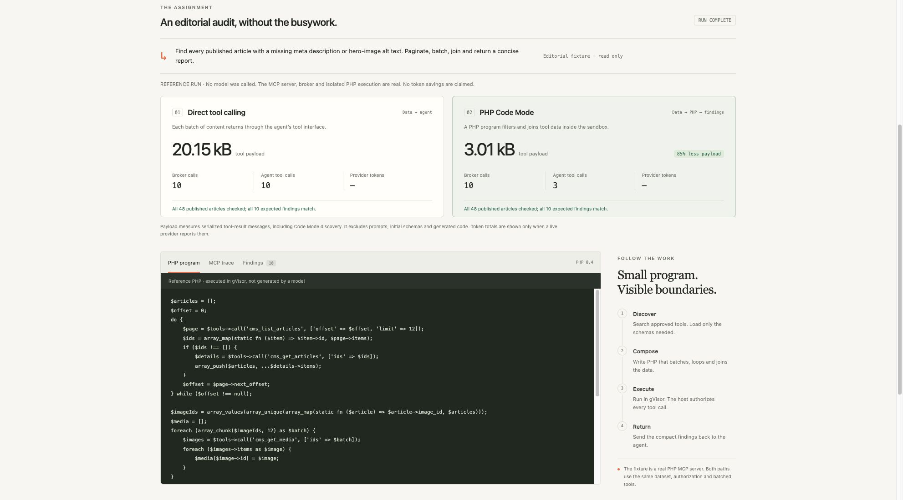

# Symfony Code Mode

Give an MCP-capable agent a PHP runtime for composing approved tools. The human asks and refines the task in their agent; Code Mode paginates, batches, joins and filters data in isolation, then returns compact findings. The Symfony AI demo measures the same workflow.



The reusable [Composer package](packages/php-code-mode/README.md) exposes `tools_search`, `tools_describe` and `php_execute`. Agents can compose workflows without a custom orchestration tool for every question. The host authorizes every tool call; generated PHP runs in gVisor with no network, host mounts or credentials. [Security model and runtime choice](packages/php-code-mode/docs/security.md).

Built for the [Symfony AI & MCP Hackathon](https://symfony.com/hackathon) with Symfony 7.4, Symfony AI 1.0 beta and the PHP MCP SDK 0.9. The judge demo is **Symfony-only**. A separate [Drupal DDEV proof](examples/drupal/README.md) verifies an authorized read and a restricted-content denial through Tool API and the same isolated runner.

## The proof

The editorial audit checks **48 articles** and returns the same **10 findings** through both paths, using **10 batched MCP calls each**. The [committed with/without baseline](docs/reference-baseline.md) measures **20,154 bytes** of tool-result payload for direct calls and **3,014 bytes** for Code Mode, including discovery: **85% less**. Both sides are available in the workbench on a fresh checkout.

The animation illustrates those measured results. Reference mode uses checked-in PHP; MCP calls and sandbox execution are real. Payload excludes prompts, initial schemas and generated code. **This is not a model-token savings claim.** [Verification record](packages/php-code-mode/docs/verification.md).

**Real Symfony AI + Hugging Face: both answers now verified.** The [matched live comparison](docs/huggingface-comparison.md) uses the same model, question, data and permissions. Direct tools used **11 requests / 43,979 tokens**; Code Mode used **5 requests / 12,597 tokens**, with **10 correct findings and 10 MCP reads each**. That is **71.4% fewer provider tokens in this pair**, not a repeated benchmark. The workbench shows generated PHP, actual calls, per-request usage and all retained attempts, including the original incomplete answers.



*Screenshot refreshed on 1 November 2026; reference execution recorded on 31 October. This is a tested development proof, not an audited public execution service.*

The workbench also shows a [real two-turn Codex conversation](docs/codex-conversation.md): an audit, then a follow-up that recomputes shared-image repair priorities. Select either turn to inspect its exact generated PHP, returned answer and actual MCP requests, with **20 host-recorded upstream calls** across both executions. [View the captured follow-up](docs/images/codex-proof.jpg).

A second [real Codex conversation](docs/boundary-recovery.md) makes security useful: a draft read is denied, the agent proposes a permitted alternative, and the follow-up audits **48 published articles in four calls**. Inspect the exact PHP, host denial and successful calls in the workbench’s **Boundary recovery** section. This capture is a CLI rehearsal; manual desktop footage remains pending.

[Record the 90-second judge demo](docs/demo/README.md): actual Codex footage, readable PHP, recorded calls and security proofs. In the workbench, choose **Generated PHP → Present PHP** for the large source view.

## Add it to Symfony

The [small Symfony bundle](packages/symfony-code-mode/README.md) registers explicitly approved read services:

```yaml
code_mode:
    identity_provider: App\CodeMode\DemoIdentityProvider
    tools:
        - App\CodeMode\ReadArticle
        - App\CodeMode\ListPublishedArticles
```

Run `php bin/console code-mode:doctor` to check local prerequisites, then connect `php bin/console code-mode:serve --no-debug` to your agent. The host supplies identity and permissions; each conversation retains its own two-attempt budget. The core and integration packages are Composer path dependencies here, not yet published to Packagist. An optional Symfony AI toolbox uses the same session. [Upstream contribution proposals and executable checks](docs/contributing/README.md).

## Run locally

Requires PHP 8.2+ CLI with `pcntl`/`posix`, Composer 2, and a dedicated Linux Docker host with gVisor. Follow the [sandbox setup](packages/php-code-mode/README.md#run-the-proof) once to install `runsc`. Ordinary Docker alone is insufficient.

```bash
git clone https://github.com/ronaldtebrake/symfony-hackathon.git
cd symfony-hackathon
composer install
# Use the Docker context connected to your dedicated sandbox host:
docker build -t php-code-mode-runner:proof packages/php-code-mode/runner
export CODE_MODE_IMAGE="$(docker image inspect --format '{{.Id}}' php-code-mode-runner:proof)"
php bin/console code-mode:doctor
composer demo
composer demo:security
composer start
```

Open [the workbench](http://127.0.0.1:8000/demo) to inspect the recorded Codex conversation, separate comparison and security proof. Viewing the checked-in Codex capture needs no API key or sandbox run. The fixed comparison and security programs are labelled **no model called**. The security report records an authorized read, a denied tool call, and an infinite loop stopped by the watchdog, with host traces and a per-container cleanup check. `/health` returns JSON. Stop the preview with Ctrl+C.

To capture fresh live generation, set `HUGGINGFACE_API_KEY` in ignored `.env.local`, then run `php bin/console code-mode:huggingface-compare --no-debug`. The default model is `openai/gpt-oss-120b`; calls consume inference credits. Reports include provider token usage only when supplied. The reviewed capture can be viewed without a key. See [live comparison and reproduction](docs/huggingface-comparison.md), [comparison setup](docs/demo.md) and the [90-second recording pack](docs/demo/README.md).

Connect `php bin/console code-mode:mcp` as a STDIO server in your agent. Ask follow-up questions and clarify scope in that conversation; the workbench is a read-only evidence viewer. The host retains all permissions and limits. See [Codex setup](docs/codex.md) and [the live two-turn conversation with generated PHP and actual calls](docs/codex-conversation.md).

## Verify

```bash
composer check          # Configuration, app and package unit/integration checks
composer test:sandbox  # Real adversarial PHP; requires the configured gVisor host
composer test:demo     # Real MCP + gVisor comparison and external MCP client
```

Run the sandbox suites sequentially on a dedicated test Docker endpoint. The demo also exposes `tools_search`, `tools_describe` and `php_execute` over STDIO: `php bin/console code-mode:mcp`. [Verification record](packages/php-code-mode/docs/verification.md).

The Symfony reference audit, real Symfony AI + Hugging Face audit, live Codex conversations, Symfony bundle execution, and local Drupal STDIO authorization proof are verified. Drupal HTTP authentication remains unverified. Submission needs a public runnable repository and a 90-second video by **22 November 2026, 18:00 CET**.
