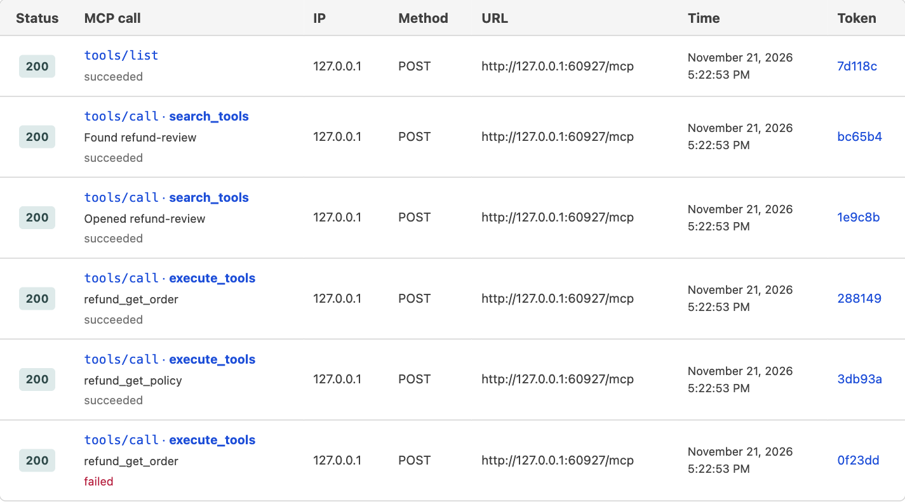

# Symfony Code Mode

**Find the right Symfony tools, then follow the team’s procedure.**

We started with a growing catalog. Why load every tool definition into an agent’s context to answer one question? Symfony Code Mode exposes two tools over the Model Context Protocol (MCP) by default. `search_tools` finds tools the caller can access. `execute_tools` calls their Symfony AI handlers.

Finding the right readers still leaves the agent to work out how they fit together. A **Group** lets a team publish its procedure alongside the tools it uses. We prototyped the MCP working group’s draft so a client can discover both on the same connection.

[](https://ronaldtebrake.github.io/symfony-hackathon/#judge-demo)

[Watch the narrated 90-second demo](https://ronaldtebrake.github.io/symfony-hackathon/#judge-demo) · [Watch on YouTube](https://youtu.be/ZYp0VkEEOCs) · [Try it in your MCP client](#try-it-locally)

**What makes it Code Mode–ready?** One tool can return a field another tool takes as input. In the film, the agent follows the team’s Group, using the order’s `policyId` to read its policy. Symfony checks permission again for the second order and denies the read. Clients can make these calls one at a time or compose them in code. [See a separate run with Claude’s JavaScript and four MCP calls](https://ronaldtebrake.github.io/symfony-hackathon/#code-mode-ready)

[](https://ronaldtebrake.github.io/symfony-hackathon/#mcp-architecture)

We started with agent-written PHP in a sandbox. Letting the client run its own code brought the server back to ordinary Symfony hosting. We built the catalog and prototyped the MCP working group’s Groups proposal using Symfony AI tool definitions and the PHP MCP SDK. [Design journey](https://ronaldtebrake.github.io/symfony-hackathon/#journey)

## Try it locally

With PHP 8.2+ and Composer 2.5+, start the local Symfony MCP server. Leave it running.

```sh
git clone https://github.com/ronaldtebrake/symfony-hackathon.git
cd symfony-hackathon
composer install
composer demo:serve
```

Open the **`examples/support` folder** as a local project in Claude Code or Codex (desktop or CLI). Trust the project and approve `symfony_code_mode` if prompted. Both clients have a project configuration that fetches the demo credential for you. Open `/mcp` to check for `search_tools` and `execute_tools`, then ask:

> Please find and follow our team’s refund procedure for order R-1042. What should I tell the customer?

[Connect another MCP client, try revocation, or inspect the native Groups trace](docs/codex.md#run-the-film-prompts)

**What you’ll see in Symfony Profiler.** In this PHP MCP SDK replay, search finds and opens the refund Group. The order and policy reads succeed for R-1042. Symfony denies the order read for R-1043.

[](https://ronaldtebrake.github.io/symfony-hackathon/#mcp-profiler)

## What we can contribute

We can share a catalog recipe for Symfony AI tools, a Groups compatibility test for the PHP MCP SDK, and traces for the MCP working group showing what happens when access changes after discovery. [Contributions and evidence](https://ronaldtebrake.github.io/symfony-hackathon/#contributions)
