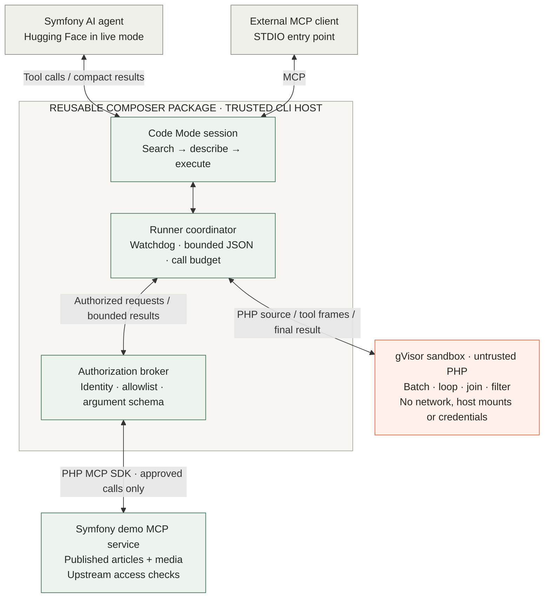

# PHP Code Mode for Symfony

**Let the agent write the workflow. Let PHP do the data processing. Keep permissions with the host.**

A Symfony AI agent can discover MCP tools and write a small PHP program to compose them: paginate, batch, join and filter, then return compact findings. Intermediate data is processed inside an isolated runner, reducing the data that passes through the model's context. Every tool call still requires host authorization.

The reusable [Composer package](packages/php-code-mode/README.md) provides the runner, broker and progressive discovery interface: `tools_search`, `tools_describe`, `php_execute`. A Symfony application can adopt Code Mode around its approved MCP tools without writing a custom orchestration tool for every question.

Built for the [Symfony AI & MCP Hackathon](https://symfony.com/hackathon) with Symfony 7.4, Symfony AI 1.0 beta and the PHP MCP SDK 0.9. **The first demo is Symfony-only.** Drupal's Tool API is a later integration on the same foundation.

## The proof

> Find every published article with a missing meta description or hero-image alt text.

The Symfony demo coordinates a real PHP MCP service and a gVisor runner. Both approaches audit **48 articles**, return the same **10 findings**, and make the same **10 batched MCP calls**. In the verified reference run, tool-result payload falls from **20,154 to 3,014 bytes — 85% less**.


*Actual local workbench, 31 October 2026. Reference mode uses checked-in PHP; MCP calls and sandbox execution are real. Payload includes Code Mode discovery but excludes prompts, initial schemas and generated code. This is not a model-token savings claim.*

## Architecture



Tool requests cross the sandbox boundary through the coordinator and broker. Credentials stay on the host; generated code cannot grant itself access. The demo permits **15 seconds, 128 MiB and 30 tool calls per attempt**, with at most two attempts. Model output and tool data remain untrusted.

Docker supplies familiar deployment tooling; gVisor adds a userspace-kernel boundary while retaining native PHP. There is no ordinary-Docker fallback. See the [runtime comparison and security limits](packages/php-code-mode/docs/security.md). This is a tested development proof, not an audited public execution service.

## Run locally

Requires PHP 8.2+ CLI with `pcntl`/`posix`, Composer 2, and a dedicated Linux Docker host with gVisor. Follow the [sandbox setup](packages/php-code-mode/README.md#run-the-proof) once to install `runsc`. Ordinary Docker alone is insufficient.

```bash
git clone https://github.com/ronaldtebrake/symfony-hackathon.git
cd symfony-hackathon
composer install
# Use the Docker context connected to your dedicated sandbox host:
docker build -t php-code-mode-runner:proof packages/php-code-mode/runner
export CODE_MODE_IMAGE="$(docker image inspect --format '{{.Id}}' php-code-mode-runner:proof)"
composer demo
composer start
```

Open [the workbench](http://127.0.0.1:8000/demo). The reference run needs no API key: it executes real PHP and MCP calls with a checked-in program, explicitly labelled as **no model called**. `/health` returns JSON. Stop the preview with Ctrl+C. Execution starts from the CLI; the web page only displays local reports.

For live generation, set `HUGGINGFACE_API_KEY` in ignored `.env.local`, then run `composer demo -- --mode=live`. The default model is `openai/gpt-oss-120b`; calls consume inference credits. Reports include provider token usage only when supplied. See [demo setup, Drupal connection and 90-second walkthrough](docs/demo.md).

## Verify

```bash
composer check          # Configuration, app and package unit/integration checks
composer test:sandbox  # Real adversarial PHP; requires the configured gVisor host
composer test:demo     # Real MCP + gVisor comparison and external MCP client
```

Run the sandbox suites sequentially on a dedicated test Docker endpoint. The demo also exposes `tools_search`, `tools_describe` and `php_execute` over STDIO: `php bin/console code-mode:mcp`. [Verification record](packages/php-code-mode/docs/verification.md).

The Symfony reference audit and mocked-provider AI pipeline are verified locally. Live Hugging Face inference is the next verification step. Drupal is optional follow-on work. Submission needs a public runnable repository and a 90-second video by **22 November 2026, 18:00 CET**.
