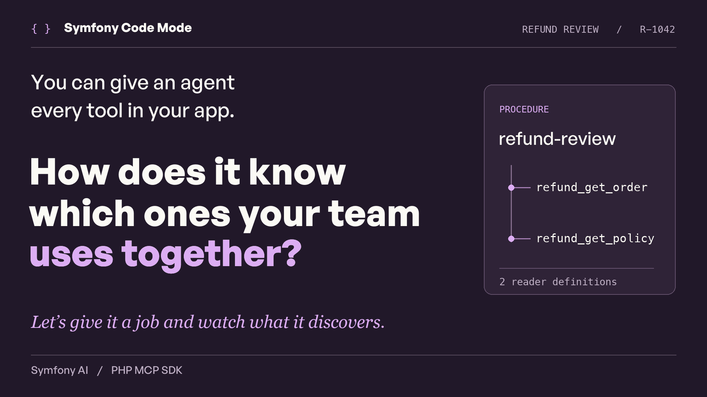

# Symfony Code Mode

An agent reviewing a refund needs the order and its policy. How should it find those two tools in a Symfony application with a hundred? We built a searchable MCP catalog and prototyped named groups so a team can tell a client which readers belong together.

[Watch the 90-second demo on GitHub Pages](https://ronaldtebrake.github.io/symfony-hackathon/#demo-tour) · [See how a prompt reaches Symfony](docs/reusable-workflows.md#how-an-mcp-call-reaches-symfony)

[](https://ronaldtebrake.github.io/symfony-hackathon/#demo-tour)

**The reusable catalog** advertises `search_tools` and `execute_tools`. The caller gets matching schemas on demand. With 10 or 100 synthetic tools, the initial two definitions took 239 tokens. Symfony checks the current user, arguments and call budget on each read. [Package](packages/symfony-code-mode/README.md) · [Schema measurement](docs/evidence/catalog-scaling.json)

**The Groups prototype** implements tool discovery from the MCP working group’s draft. In the recorded demo, the host opens `refund-review`. A Symfony AI agent using Hugging Face reads the order, follows its policy ID and recommends manual review. After revocation, the PHP MCP SDK delivers the repeat call to Symfony. Symfony denies it before the reader runs. [See the actual exchanges](https://ronaldtebrake.github.io/symfony-hackathon/#refund-wire)

## Try it locally

With PHP 8.2+ and Composer 2, run these commands.

```sh
git clone https://github.com/ronaldtebrake/symfony-hackathon.git
cd symfony-hackathon
composer install
composer proof:discovery
```

The command exercises both discovery routes in a fresh Symfony test kernel, then verifies the recorded refund exchanges and model answers. It needs no provider key or sandbox. Run `composer start` to [open the local workbench](http://127.0.0.1:8000/demo).

## What we can contribute

The reproducible case for maintainers is a permission change **after discovery**. A client knows the tool and its arguments, yet the next read must honor the current permissions. Next we want to let the model choose among several plausible groups. The host chose the group in this demo. [Upstream contribution notes](docs/contributing/README.md) · [Why we moved from sandboxed PHP to JSON and Groups](docs/reusable-workflows.md)
