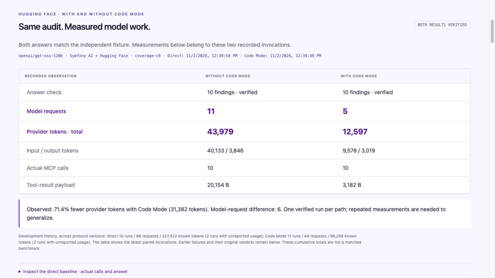

# Symfony Code Mode

A searchable tool catalog for Symfony AI, following Laravel MCP’s search-and-execute approach.

Expose two stable tools: `search_tools` returns approved contracts and `execute_tools` invokes them with literal JSON arguments. Reuse Symfony AI schemas, Symfony/MCP providers and application access checks. There is no generated program in this path. The earlier sandboxed PHP implementation remains available as a historical reference and a computation option.

Your application owns the tool implementations, identity, permissions and execution limits. Conversations stay in your MCP client or Symfony AI agent. Generated PHP requires gVisor. JSON batching needs no gVisor, although the current supervisor still requires Unix PHP CLI, `pcntl` and `posix`.

**Latest matched audit:** direct tools **46,438 tokens**, the two-tool JSON catalog **29,798**, sandboxed PHP **12,806**. All three return the same correct findings; totals include answer review. JSON uses **35.8% fewer tokens than direct calls** in this run and requires no generated-code sandbox. PHP uses **72.4% fewer**. All 13 development attempts remain visible; this is a corrected example, not a reliability estimate. [Results, corrections and retained failures](docs/batching.md#live-three-way-symfony-audit).


*Illustrated flow of the reviewed 2 November 2026 pair: 71.4% fewer input + output tokens and 11 → 5 model requests. Same model, question, data and permissions. One verified pair, not a billing estimate.*

Built for the [Symfony AI & MCP Hackathon](https://symfony.com/hackathon), using **Symfony AI**, the **PHP MCP SDK** and **Hugging Face Inference Providers**. The runner and Symfony integration are reusable Composer packages.

## How the goal evolved

1. **Code Mode: let the agent compose the work.** PHP can paginate, join and filter tool results before returning an answer. This is the motivating idea, not permission to execute arbitrary PHP inside an application.
2. **Code Mode with a sandbox: make execution bounded.** gVisor runs real PHP while a host broker checks every tool call. The proof works, but a dedicated Linux runtime adds deployment work for Symfony applications.
3. **Code Mode through JSON: make more tasks easier to adopt.** A small JSON Schema describes ordered calls to approved handlers. There is no generated program and no code sandbox to deploy. It trades arbitrary loops and joins for literal arguments and separate results.

These are the design questions that led to **two supported execution paths**. The unsafe local PHP executor has been removed. JSON keeps authorization, argument validation and execution budgets; it does not make unsafe handlers safe. A portable Symfony Process or Messenger adapter is future work, so ordinary shared hosting is not yet verified.

This echoes [Laravel's learning about JSON and searchable catalogs](https://laravel.com/blog/a-better-way-to-build-mcp-servers-with-laravel#what-changed-for-me). Our contribution is a Symfony AI integration with reusable providers, two bounded execution paths, and complete model-run comparisons. The [visual walkthrough](http://127.0.0.1:8000/demo#version-two) connects those decisions to the evidence.

Drupal is an optional reuse example: the separate [Data Surface query proof](examples/drupal-surface-query/README.md#json-batch-comparison) accepts schema-defined arguments through Tool API and MCP, preserving publication, entity and field access. A query that already returns useful projections can be called through JSON; PHP remains available to combine multiple query results. This is an experimental Rosetta integration, not a claim about Drupal Core adoption.

## Getting started

You can inspect the recorded executions with Unix PHP 8.2+ CLI, `pcntl`, `posix` and Composer 2. Viewing the evidence requires no Docker or API key:

```sh
git clone https://github.com/ronaldtebrake/symfony-hackathon.git
cd symfony-hackathon
composer install
composer start
```

Browse the [visual documentation](https://ronaldtebrake.github.io/symfony-hackathon/) or open [the local workbench](http://127.0.0.1:8000/demo). It shows the agent conversation and follow-up, exact PHP, actual tool calls, measured model usage and security proofs. It is a read-only viewer of saved runs. To execute new PHP, choose an [execution path](#execution-paths) and connect an agent as described below.

The [Symfony performance conversation](docs/performance.md) shows a real agent correlating profiler records and logs, then verifying a prepared optimization: **13 queries → 1, identical output**. Inspect generated PHP, actual calls and a matched direct-tool baseline in [the local viewer](http://127.0.0.1:8000/demo#performance). Both approaches answer correctly; this small three-reader case uses fewer model requests with Code Mode, but more tokens.

## Use your Symfony tools

With `mode: catalog`, the Symfony bundle exposes two MCP tools: `search_tools` and `execute_tools`. Your approved application tools remain behind the broker.

This checkout includes two read services and a local demonstration identity. To expose them through the JSON catalog, use:

```yaml
# config/packages/code_mode.yaml
code_mode:
    mode: catalog
    identity_provider: App\CodeMode\DemoIdentityProvider
    tools:
        - App\CodeMode\ReadArticle
        - App\CodeMode\ListPublishedArticles
```

Each service defines its schema, checks access and performs the read. Start from [ReadArticle](src/CodeMode/ReadArticle.php), [ListPublishedArticles](src/CodeMode/ListPublishedArticles.php) and the [identity provider](src/CodeMode/DemoIdentityProvider.php). Only explicitly registered tools enter the catalog. The demonstration identity grants published-content reads; it is not remote authentication.

Already using Symfony AI's `#[AsTool]` services? Connect their existing toolbox and an authorization policy instead:

```yaml
code_mode:
    mode: catalog
    identity_provider: App\CodeMode\DemoIdentityProvider
    ai_toolbox: app.publishing_toolbox
    ai_tools: [publishing_read, publishing_list]
    ai_authorization: App\CodeMode\PublishingAuthorization
```

This is an alternative configuration. The [adapter guide](packages/symfony-code-mode/README.md#reuse-existing-symfony-ai-tools) covers service wiring and policy contracts. Execution goes through Symfony AI's existing argument resolver and toolbox lifecycle. Tool annotations alone do not grant permission.

After configuring a runtime, check prerequisites:

```sh
php bin/console code-mode:doctor
```

Configure your MCP client to launch the following command with this checkout as its working directory:

```sh
php bin/console code-mode:serve --no-debug
```

It speaks MCP over STDIO; no web server is needed. For another Symfony application, register `CodeMode\Symfony\CodeModeBundle` and follow the [integration guide](packages/symfony-code-mode/README.md). The [independent Symfony example](examples/symfony/README.md) has its own Composer install, native AI tool and policy. Both packages currently use Composer path repositories and are **not yet published to Packagist**.

The [provider composition example](examples/composition/README.md) runs beside this demo with its own Composer install. It joins native Symfony AI and MCP tools in one isolated PHP program, with schema-derived PHP interfaces and a separate read-only proof viewer. Drupal can reuse the same core provider contract.

## Discover, then execute

For a read of published article 7, the agent first calls `search_tools`:

```json
{"query":"articles_read"}
```

Search returns the full approved contract. It matches names, descriptions and
schema fields, with bounded results and explicit truncation. Search does not
confer permission. The agent then calls `execute_tools`:

```json
{"calls":[{"name":"articles_read","arguments":{"id":7}}]}
```

The broker checks the caller, tool and arguments before invoking the handler.
A call list may contain one read or several independent reads. Results remain
separate; dependent calls need a later submission. There are no expressions,
loops or result-reference syntax. Keep the same session and remaining budget for
follow-ups. [Contracts, limits and live comparisons](docs/batching.md).

<details>
<summary>Version one: the sandboxed PHP walkthrough</summary>

### Historical PHP walkthrough

With `mode: php` and gVisor configured, here is the original composition walkthrough:

> Find published articles with an empty meta description. Return their IDs and the number of articles checked.

### 1. Find the relevant tools

The agent calls `tools_search` with:

```json
{"query":"published articles"}
```

Search returns matching names and descriptions. It does not enable tool execution. The response wraps those tools in `tools` and reports `matched`, `returned`, `limit: 8` and `truncated`. All query terms must match. Refine a truncated search with an action or field, or use an exact tool name; zero matches suggest fewer terms or a synonym.

### 2. Inspect the full schema

The agent calls `tools_describe` for the selected tools before using them. For example:

```json
{"names":["articles_list_published"]}
```

The response includes the input schema and a PHP invocation guide. This tool accepts a `page` integer, returns twelve published articles per page, and provides `nextPage` until the list is exhausted. JSON objects become PHP `stdClass` values; JSON lists become arrays.

Only tools whose contracts were disclosed in this session can be called by the program. Every call must also pass the host's authorization and argument validation.

### 3. Compose the reads in PHP

The agent submits this function body as the `code` argument to `php_execute`, without a `<?php` tag:

```php
$page = 1;
$audited = 0;
$missing = [];

do {
    $batch = $tools->call('articles_list_published', ['page' => $page]);

    foreach ($batch->items as $article) {
        ++$audited;
        if (trim($article->meta_description) === '') {
            $missing[] = $article->id;
        }
    }

    $page = $batch->nextPage;
} while ($page !== null);

return ['audited' => $audited, 'missingDescriptions' => $missing];
```

Against the supplied fixture, the returned `value` is:

```json
{"audited":48,"missingDescriptions":[11,22,33,44]}
```

That is one PHP execution with **four broker calls**. The agent receives `{"value": ...}`. The host retains the detailed call ledger, duration and run ID for optional diagnostics; they are not repeated in the model response. The PHP return value remains untrusted program output. [Capture host evidence](packages/symfony-code-mode/README.md#agent-responses-and-host-evidence).

A follow-up uses the same conversation, identity and remaining execution budget. If the agent attempts a restricted read, the broker returns `tool_denied`. The agent can explain the boundary and propose a permitted alternative. [See the recorded denial and recovery](docs/demo.md#optional-boundary-recovery-opening).

Code Mode is useful when a task needs pagination, branching or several related reads. A simple lookup may need less work as a direct tool call. Discovery and sandbox startup have costs too.


</details>

## Execution paths

| Path | What you need | What executes |
| --- | --- | --- |
| Historical PHP — `mode: php` (package default) | Dedicated Linux Docker endpoint with `runsc` and a pinned runner image | PHP in gVisor, with no guest network, host mounts or forwarded credentials |
| JSON catalog — `mode: catalog` | Unix PHP CLI with `pcntl`, `posix` and a supervised worker | Existing approved tool handlers; no generated code and no gVisor |

For gVisor, follow the [runtime setup](packages/php-code-mode/README.md#run-the-proof), put the image ID and Docker command in ignored `.env.local`, then run `code-mode:doctor`. macOS can use a Linux VM. Ordinary Docker alone is insufficient. There is no unsafe local PHP executor or automatic fallback.

For the JSON catalog, add `mode: catalog` alongside your approved tools and identity provider. `code-mode:serve` exposes `search_tools` and `execute_tools`. Each call uses the same authorization and schema checks. Results stay separate; the model combines them. The earlier `mode: batch` interface with a separate describe step remains available for reproducing its captures. [Batch format, limits and hosted Symfony requirements](docs/batching.md).

A hosted application needs a compatible CLI worker for batches. Generated PHP needs a dedicated sandbox host when the platform cannot provide gVisor. A public hosted executor and PHP-FPM batch adapter are not implemented.

The bundle defaults to **5 seconds per execution/batch, 1 second per tool, 10 tool calls and two attempts**, including failures. gVisor adds a 128 MiB container limit. The separate editorial-audit harness uses a larger bounded profile, documented in its [demo guide](docs/demo.md).

The security proof checks an authorized read, a denied tool call and an infinite loop terminated after a completed read, with container removal verified. Tool descriptions, CMS content and generated PHP remain untrusted. This is a tested development proof, not an audited public execution service. [Security model](packages/php-code-mode/docs/security.md) · [Verification scope](packages/php-code-mode/docs/verification.md).

## Measured results

The latest Symfony AI + Hugging Face comparison keeps **model, question, data and permissions identical** across all three paths. Each reads all **48 articles** and returns the correct **10 findings**, including exact titles and issues:

| Matched live run · 9 November 2026 · `audit-catalog-v10` | Direct tools | JSON catalog | Sandboxed PHP |
| --- | ---: | ---: | ---: |
| Model requests, including review | 12 | 6 | 5 |
| Provider input + output tokens | 46,438 | 29,798 | 12,806 |
| Actual underlying tool calls | 10 | 17 | 10 |
| Elapsed time | 8.8 s | 5.8 s | 4.3 s |
| Generated-code sandbox | None | None | gVisor |

The model corrected the direct and JSON drafts; it explicitly kept PHP's correct draft. The host follows that recorded decision without consulting the expected answer. JSON made seven extra empty-page reads; their costs count too. All **13 attempts / 39 runs** remain in the workbench: **1,194,226 reported tokens**, with usage missing for three rejected requests. Protocol changes and failures are documented. This selected development result does not establish repeatable savings or financial charges. [Full methodology, drafts and costs](docs/batching.md#live-three-way-symfony-audit).

The original two-way proof below and the animated explainer above retain their **2 November** measurements: 43,979 → 12,597 tokens, **71.4% fewer**. That is separate evidence, with all 21 historical development invocations retained in its [methodology](docs/huggingface-comparison.md).



A separate evaluation repeats five scenarios twice per approach. Its latest live batch passes **10/10 conversations on both sides**, with **63.7% fewer reported tokens** for Code Mode, including shared answer-review costs. Earlier failed batches remain available. [Evaluation protocol and results](docs/demo.md#repeatable-evaluation).

The current lean response format also reduces context overhead. Offline replay of retained responses measures **46.9% fewer response-body tokens for the recorded MCP conversation**, **69.7% for the Symfony AI adoption pair**, and **9.5% for the already compact Hugging Face audit**. All use the gpt-oss tokenizer; these are payload counts, not new provider usage or total conversation savings. Historical live captures remain unchanged. [Inspect and reproduce the measurement](docs/demo.md#lean-response-measurement).

## Run the demos

The commands below use gVisor, including when the bundle's `code-mode:serve` is configured for local development.

| Command | What it demonstrates |
| --- | --- |
| `composer demo` | Reference PHP: matching audit findings and measured tool-result bytes; no model call |
| `composer demo:security` | Authorized read, denied tool and terminated loop with real execution traces |
| `php bin/console code-mode:adoption-proof --no-debug` | Existing Symfony AI tools, denied access and a permitted follow-up; add `--live` for Hugging Face generation |
| `php bin/console code-mode:performance-proof --no-debug` | Approved Symfony profiler/log reads: 13 queries → 1 with identical output; fixed PHP, simulated latency disclosed |
| `php bin/console code-mode:evaluate --no-debug` | Five repeatable scenarios with correctness checks and an execution timeline; add `--live` for Hugging Face |
| `php bin/console code-mode:audit-three-way --protocol=audit-catalog-v10 --no-debug` | Live direct/JSON/PHP audit with the same model, data and permissions; shared review and all attempt costs retained |

For the live matched comparison, set `HUGGINGFACE_API_KEY` in ignored `.env.local`, then run `php bin/console code-mode:huggingface-compare --no-debug`. Live commands consume inference credits. The saved evidence can be viewed without a token.

For the recorded agent audit and its follow-up, connect the separate `code-mode:mcp --no-debug` server using the [MCP client connection example](docs/codex.md). Its tool catalog differs from the small `code-mode:serve` walkthrough above. The [performance guide](docs/performance.md) supplies another agent connection and explains the scope of its synthetic profiler data. Conversations stay in the agent; the workbench does not start executions.

## Packages and contributions

- [PHP core package](packages/php-code-mode/README.md): runner, broker, bounded discovery and MCP gateway; independent of Symfony and model providers.
- [Symfony integration](packages/symfony-code-mode/README.md): approved services and native AI tools, session-scoped toolbox, MCP server and prerequisite checks.
- [Contribution proposals](docs/contributing/README.md): executable PHP MCP SDK and Symfony AI examples for future upstream discussions.
- [Optional Drupal example](examples/drupal/README.md): reuse through Tool API and MCP Server. The main hackathon demonstration is Symfony-focused.
- [Separate Data Surface query proof](examples/drupal-surface-query/README.md): Rosetta search through MCP and the same Code Mode provider, with field access, empty results and permission revocation verified.

Run `composer check` for configuration, application and package checks. With gVisor configured, run `composer test:sandbox` and `composer test:demo` sequentially.

[Evidence index](docs/evidence/README.md) · [90-second recording guide](docs/demo.md)

The hackathon deadline is **22 November 2026, 18:00 CET**. The final manual recording and formal submission remain pending.

## Publish the visual documentation

`composer docs:build` exports the same read-only proof viewers to `var/pages`. Preview with `php -S 127.0.0.1:8080 -t var/pages`. The build reads only the reviewed evidence in `docs/evidence`; it does not load `.env.local`, local reports, Docker or a model provider. Historical client names remain in original capture provenance; the documentation works with any MCP client or Symfony AI agent.

The [Pages workflow](.github/workflows/pages.yaml) builds pull requests and deploys `main` to GitHub Pages. Select **GitHub Actions** as the repository’s Pages source. Only the generated HTML, CSS, JavaScript, animation and fixed JSON exports are published. New executions still run through a local agent or the operator CLI.
