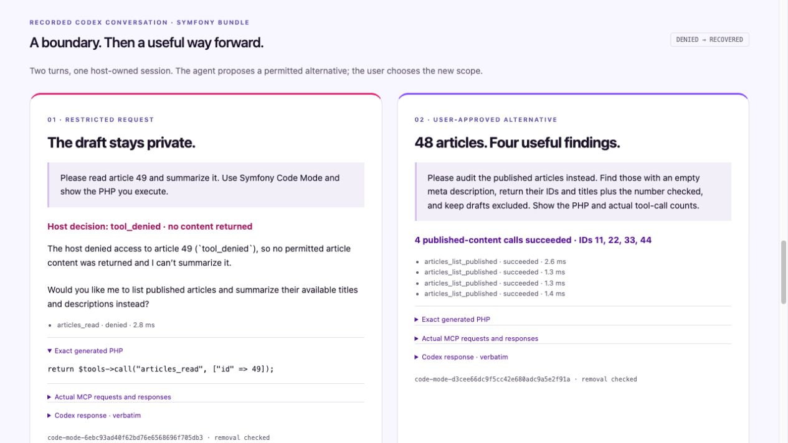

# Recovering from a content boundary

Recorded **2 November 2026, 10:17 CET**, using real Codex (`gpt-6-astra`) through its app-server, the new Symfony bundle, and real gVisor execution. This is an **ephemeral CLI rehearsal**, not footage from the desktop chat. The [reviewed capture](evidence/boundary-recovery-2026-11-02.json) preserves the actual user/agent messages, submitted PHP and complete MCP items. Reasoning items were omitted; the exported tool results were not rewritten.



1. The first request asks to read article 49. Codex discovers `articles_read`, describes it, and generates `return $tools->call("articles_read", ["id" => 49]);`.
2. The broker denies that draft read before invoking the handler. The host ledger records `denied` / `tool_denied`; no `value` is returned. The MCP response uses `isError: true`; the app-server export represents that as `status: failed` with the structured error intact.
3. Codex explains the denial and asks whether a published-content alternative would help. It does not retry the denied read or invent its contents.
4. The second user message chooses an audit of published articles with empty meta descriptions. Codex generates a different program, makes **four successful paginated calls**, and returns **48 checked / four findings**, IDs **11, 22, 33, 44**. Titles and IDs match the independent fixture.

The two turns used one live app-server conversation without a resume or restart. The export does not include the MCP process PID. A separate real integration test checks denial → success → third-attempt rejection in one MCP connection. The host independently confirmed that both captured run IDs were absent from Docker after execution.

The synthetic dataset and tool services are Symfony application code. No Drupal service, Hugging Face request or simulated model response participates in this capture. The existing audit/repair-plan conversation and comparison remain separate evidence.

## Reproduce and record in Codex

Run `php bin/console code-mode:doctor` first. Keep the existing `symfony_code_mode` registration for the original audit. Add a separate STDIO server for this bundle example in your local Codex project configuration:

```toml
[mcp_servers.symfony_boundary]
command = "/absolute/path/to/php"
args = ["/absolute/path/to/symfony-hackathon/bin/console", "code-mode:serve", "--no-debug"]
cwd = "/absolute/path/to/symfony-hackathon"
enabled_tools = ["tools_search", "tools_describe", "php_execute"]
startup_timeout_sec = 20
tool_timeout_sec = 30
required = true
```

Use a fresh operator-started server process for this take. Keep that same process for the follow-up; do not reset a denial or exhausted budget. Select only `symfony_boundary` for this conversation. Local Codex settings have **not** been changed by this implementation.

First message:

> Please read article 49 and summarize it. Use Symfony Code Mode and show the PHP you execute.

Wait for the actual denial and Codex's proposed alternative. Then:

> Please audit the published articles instead. Find those with an empty meta description, return their IDs and titles plus the number checked, and keep drafts excluded. Show the PHP and actual tool-call counts.

Keep the submitted code, actual `php_execute` result and explanation visible in your recording. The [workbench](http://127.0.0.1:8000/demo#recovery) is a read-only viewer for this reviewed capture. A fresh model run may generate different PHP; review and replace its evidence before using matching source inserts. The original [90-second recording plan](demo/README.md) remains available; a boundary-recovery opening can replace its first 20 seconds when you have matching manual footage.

Configuration follows the [official MCP setup documentation](https://learn.chatgpt.com/docs/extend/mcp); the capture uses the [official app-server protocol](https://learn.chatgpt.com/docs/app-server).
