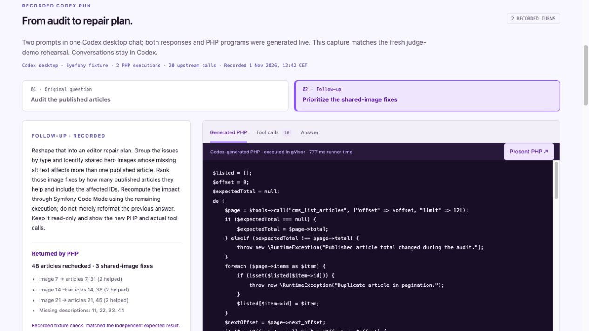
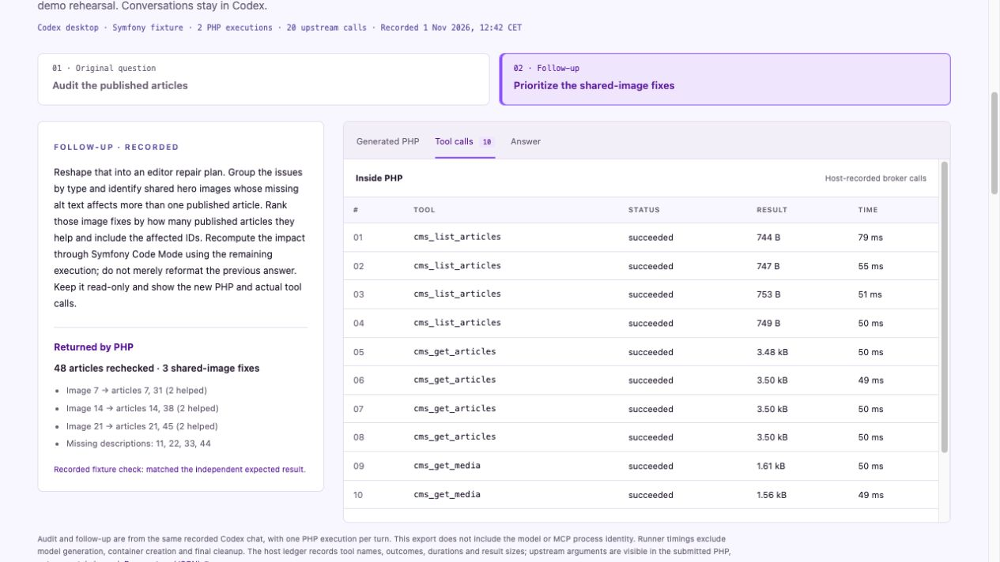

# Use Symfony Code Mode from Codex

Ask the question in Codex. It discovers the approved MCP tools, writes PHP, submits it to the isolated runner and answers from the result. Follow-up questions stay in that conversation. The workbench is a read-only viewer for the recorded Codex rehearsal, comparison and security proofs.

## Connect this project

Set up the [gVisor runtime](../packages/php-code-mode/README.md#run-the-proof) and the project's ignored `.env.local` first. This connection uses the read-only Symfony fixture; it does not connect to Drupal or need a Hugging Face token. Codex uses its own existing sign-in and model access.

Create `.codex/config.toml` in the project with your absolute paths:

```toml
[mcp_servers.symfony_code_mode]
command = "/absolute/path/to/php"
args = ["/absolute/path/symfony-hackathon/bin/console", "code-mode:mcp", "--backend=fixture", "--no-debug"]
cwd = "/absolute/path/symfony-hackathon"
enabled_tools = ["tools_search", "tools_describe", "php_execute"]
startup_timeout_sec = 20
tool_timeout_sec = 45
required = true
```

The local config is ignored by Git. Keep runtime credentials in `.env.local`, outside tool arguments and generated PHP. The 45-second client timeout allows for setup and cleanup; it does not change the runner's 15-second execution limit.

Run `codex mcp get symfony_code_mode` from this project to check registration. Restart the MCP connection in the desktop client's MCP settings, or launch `codex` from this directory. Use `/mcp` to inspect the connected server. Codex loads project MCP configuration for trusted projects; the CLI and desktop share the configuration. See [OpenAI's MCP documentation](https://developers.openai.com/codex/mcp/).

## A two-turn conversation

Start with:

> Use Symfony Code Mode to audit every published article for missing meta descriptions or hero-image alt text. Show the affected article IDs and titles, and the total audited. Keep it read-only. Show the PHP you submit and the host-recorded tool calls. Use one execution so we retain the second for a follow-up.

Then reshape the request:

> Make this an editor repair plan. Group the issues by type and identify shared hero images whose missing alt text affects multiple published articles. Rank those image fixes by impact and include the affected IDs. Recompute through Code Mode using the remaining execution, and show the new PHP and actual calls.

The agent can clarify ambiguous scope before execution. User agreement cannot add permissions. Each server process permits two PHP attempts, including failures; an operator must start a new process for a new task after exhaustion. There is no agent-accessible reset. The runner retains its 128 MiB memory, 30-call limit, no guest network and per-call broker authorization.

The conversation does not write to the comparison or security-proof workbench reports. Inspect MCP calls in Codex for the submitted `php_execute.code`, its returned `value` and the host-recorded `toolCalls`. A generated explanation of a trace is not a substitute for those tool results.

## Recorded live run

The [fresh 1 November Codex conversation](codex-conversation.md), recorded at **12:42 CET**, is now the workbench's source: chat `01a196eb-12bd-7412-9fad-4d279e2cbcf8`. It contains an article audit followed by a recomputed repair plan ranked by shared-image impact. Both answers matched the independent fixture checks; all 20 upstream calls succeeded. The PHP, raw MCP requests/results and verbatim final responses come from that exact desktop chat. Prompts were sent through the desktop tools at the user's request; Codex generated the responses and programs live. The persisted export does not identify the model or MCP process.

Run `composer start` and open [Recorded Codex run](http://127.0.0.1:8000/demo#codex-run). Select the original question or follow-up, then inspect **Generated PHP**, **Tool calls** or **Answer**. The calls tab separates the host's upstream ledger from Codex's outer MCP requests, including their exact arguments and responses. The answer tab includes the returned JSON and Codex's verbatim final response.

Choose **Generated PHP → Present PHP** for large source text, line numbers, jumps to the computation and **Copy exact PHP**. Navigation highlights the selected source location; it does not simulate line execution. Press Escape to return to the calls and results. The [recording guide](demo/README.md) explains how to match a new manual Codex take to its evidence.





This reads the reviewed, checked-in [fresh desktop capture](evidence/codex-conversation-2026-11-01.json). It does not execute PHP, call a model or synchronize new Codex conversations. Selecting a turn only changes the displayed evidence. New conversations remain in Codex and are not automatically imported. The screenshot capture date is 1 November 2026; timing and verification labels describe the recorded run.
