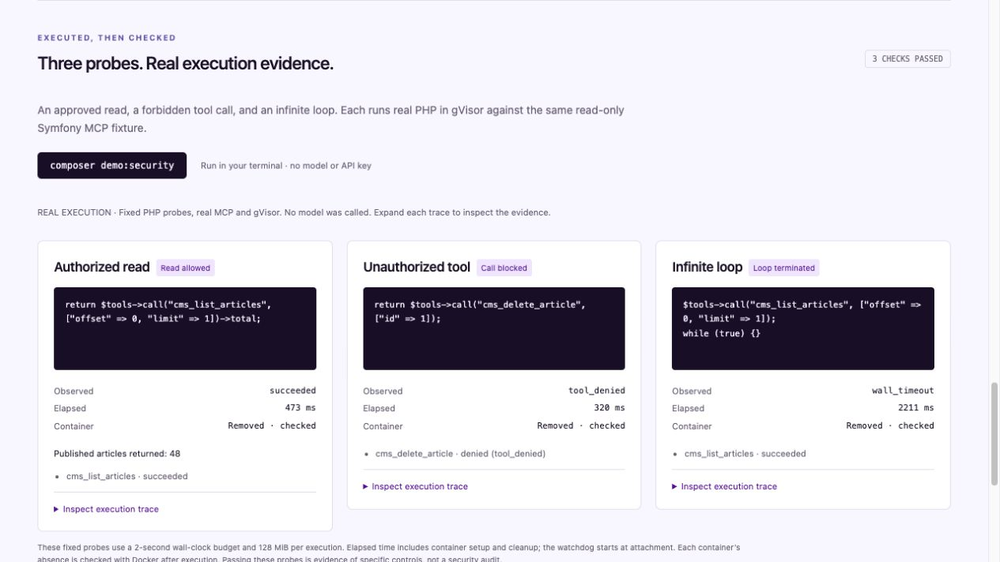

# Symfony Code Mode demo

The working slice is an editorial audit: check every published article for missing meta descriptions or hero-image alt text, with pagination, batched reads and a join between articles and media. It demonstrates orchestration in real PHP and authorization that stays outside generated code.

The first judge-facing demo is **Symfony-only**: the Symfony application runs the agent and coordinates the PHP MCP fixture and isolated runner. Drupal is an optional follow-on demo using the same Composer package, not a prerequisite for this one.

The [real Symfony AI + Hugging Face capture](huggingface-proof.md) is now available in **Symfony AI run**: exact generated PHP, ten host-recorded MCP calls, 48 audited articles, ten verified findings and measured provider usage. Reproduce it with `php bin/console code-mode:huggingface-proof --no-debug`; its report is separate from the comparison below.

## Run and inspect

1. Install root Composer dependencies and set up the [dedicated gVisor host](../packages/php-code-mode/README.md#run-the-proof). Build the runner image, then configure its immutable `CODE_MODE_IMAGE`. For an alternate CLI, set `CODE_MODE_DOCKER_COMMAND` to a trusted JSON argv array. Symfony commands read these from `.env.local`; PHPUnit sandbox suites and standalone package examples need exported environment variables.
2. Run `composer demo`, then `composer start`. Open [the workbench](http://127.0.0.1:8000/demo). Its **Recorded Codex run** section shows the checked-in two-turn conversation, generated PHP, actual MCP requests and host calls. The separate comparison shows its own PHP, calls and findings. Reference mode makes no provider calls. Comparison reports stay in ignored `var/demo/latest.json` with owner-only file permissions; the newest run replaces the previous one. If that file is absent, the viewer uses the [committed with/without reference baseline](reference-baseline.md), so inspection also works without starting a new execution.
3. For live generation, set `HUGGINGFACE_API_KEY` in ignored `.env.local` to a token with Inference Providers permission. Run `composer demo -- --mode=live`. Optionally use `--approach=code` or `--approach=direct`. Each path runs its own Symfony AI agent against `HUGGINGFACE_MODEL` (default `openai/gpt-oss-120b`). A missing key fails explicitly; there is no reference fallback.
4. Run `composer check`, then `composer test:sandbox`, then `composer test:demo`. The latter two require the pinned image/runtime and fail if unavailable. Use a dedicated endpoint and run them sequentially.

The browser cannot start executions. A fresh CLI invocation creates fresh Code Mode sessions. The MCP-facing server allows only two execution attempts over its process lifetime; restart it for a new operator-authorized task.

## Agent conversations

The human talks to their MCP-capable agent. The agent can ask clarifying questions, discover the available tools, write PHP, inspect the result and respond to the human. Symfony Code Mode supplies tool discovery and isolated execution; it does not own the conversation or provide a chat UI.

For example, a human can ask for the editorial audit, then follow up with “Group those issues and show which missing image descriptions affect multiple articles.” If scope or the desired result is unclear, the agent should clarify with the human before calling `php_execute`. Server initialization instructions describe this workflow. They guide the agent; the broker and sandbox enforce permissions independently.

Configure a local MCP client with an absolute project path:

```json
{
  "mcpServers": {
    "symfony-code-mode": {
      "command": "php",
      "args": ["/absolute/path/symfony-hackathon/bin/console", "code-mode:mcp", "--no-debug"]
    }
  }
}
```

The server exposes `tools_search`, `tools_describe` and `php_execute`. Only described, locally approved tools can execute. User agreement in a conversation cannot add permissions, expose credentials or change runtime limits. For unavailable capabilities, the agent can explain the limitation and help the human reshape the task. It must not retry a denial indefinitely.

The current proof permits **two PHP execution attempts per server process**, including failed attempts. A follow-up can use the remaining attempt; exhaustion requires the operator to start a new server process. No budget-reset tool is exposed to the agent. This bounded process lifetime is a proof limitation, not a complete conversation/session service.

This path uses the client agent's model and does not require the demo's Hugging Face key. External MCP-client tests cover discovery, two different computations and refusal of a third execution. Separately, a [live Codex conversation](codex-conversation.md) verified an audit followed by a recomputed repair plan using two different generated programs in one MCP process. See [Codex connection setup](codex.md). The external-client path does not save conversation traces to the comparison report. The workbench reads only the reviewed rehearsal capture; new conversations are not automatically imported, and viewing it needs no model or sandbox execution.

## CLI comparison harness

The Symfony AI CLI is a reproducible comparison harness, separate from the human's agent conversation. It sends the same question to direct-tool and Code Mode agents:

```bash
composer demo -- --mode=live --scenario=impact
composer demo -- --mode=live --question='Count published articles by language. Return counts.'
```

These changed questions use the read-only Symfony fixture and require live inference. Reference mode supports only the original checked-in audit. The impact scenario has an independent oracle for 48 articles, two groups of article IDs and three shared images without alt text. Custom JSON answers require supporting MCP reads but are marked **review required**, with no correctness or payload-savings badge.

Custom CLI input is limited to 2000 UTF-8 bytes, with terminal controls and invisible formatting rejected. Questions cannot change host identity, endpoints, policies or execution limits. Live questions go to the configured provider and the local report. Local tests mock provider responses while executing alternate programs through real MCP/gVisor. Real Hugging Face generation is verified for the fixed editorial audit; custom questions and a live direct-tool comparison have not been captured.

## Visible security proof

```bash
composer demo:security
composer start
```

Open [the proof viewer](http://127.0.0.1:8000/demo#security-proof). The CLI runs three fixed programs against the read-only Symfony MCP fixture, using the same broker and gVisor implementation as Code Mode:

| Probe | Required observation |
| --- | --- |
| Authorized read | PHP returns 48 published articles, with a successful `cms_list_articles` call in the host ledger. |
| Unauthorized tool | A `cms_delete_article` request is rejected with `tool_denied` and a host-recorded `denied` call. An upstream failure alone cannot pass this check. |
| Infinite loop | PHP completes an approved read, then enters `while (true) {}`. The host must report `wall_timeout`; a timeout before the read completes does not pass. |

Each fixed probe is a separate operator-authorized execution with a **2-second wall budget, 128 MiB memory and three-call maximum**. The normal agent demonstration retains its 15-second, 30-call profile and two-attempt session cap. The proof's elapsed time includes container creation and cleanup; its watchdog starts at attachment.

Both successful results and runner failures identify the host-generated container. After each run, the proof independently queries Docker for that exact name. The check passes only when the expected outcome and supporting ledger match and container absence is confirmed. Missing runtime configuration, unknown cleanup state or an unexpected error fails the proof. No success is fabricated when infrastructure is unavailable.

Reports are atomically written with owner-only permissions to `var/demo/security.json`, separately from the comparison in `latest.json`. The page reads them through a loopback-only GET endpoint, renders source/results as text and exposes the full recorded case in each expandable trace. There is no HTTP execution endpoint. These are real executions of fixed probe programs; no model is called, and this is not an external security audit.



## What is measured

The fixture contains 48 published articles, 4 inaccessible drafts and 24 reused images. An independent expected result checks all 10 findings, titles, issue types and the audited count. Successful reads of all three data tools must support the answer. Both approaches get the same task, dataset, permissions and batch-capable MCP tools; the direct baseline is allowed to batch.

The reference algorithms make the same 10 MCP calls: 4 list pages, 4 detail batches, 2 media batches. They return the same findings. The direct path returns content through the agent tool interface; PHP filters it within gVisor and returns compact findings. Reference mode supplies its program from the repository and makes zero inference requests.

`toolPayloadBytes` counts the exact UTF-8 JSON strings returned by the application toolbox. Code Mode search/describe results and errors are included. Prompts, initial schemas, generated PHP and protocol framing are excluded. These are **payload bytes, not token estimates or billing totals**. Provider token usage is shown only when Symfony AI receives usage metadata; missing usage stays blank. Compare provider totals only for successful live runs of both paths. A single run is not a reliable performance benchmark.

The host ledger includes calls completed before failed attempts, so retries do not erase their work. `incomplete` means a result was not successfully received; upstream effects may already have happened. Failed final runs never display a payload-savings badge. Duration includes setup/model work and is not a pure sandbox speed comparison.

## Drupal Tool API adapter

The Symfony judge demo and its reference dataset run without Drupal. A separate [DDEV milestone](../examples/drupal/README.md) now proves an authorized node read and an unpublished-node denial through real Drupal Tool API, MCP Server and gVisor over local STDIO. Its operator-written programs and evidence do not replace the Symfony workbench reports.

The integration uses [Tool API](https://www.drupal.org/project/tool), [MCP Server Tool Bridge](https://www.drupal.org/project/mcp_server_tool_bridge) and [Drupal MCP Server](https://www.drupal.org/project/mcp_server). The bridge exposes configured Tool API plugins and checks access against the MCP account. It does not itself provide the editorial audit tools: install or write read tools for published article metadata and media, with bounded pagination/batching and object access checks.

Set up a dedicated read-only Drupal account and MCP authentication, configure the Tool Bridge mappings, and inspect the actual names and schemas returned by that site's `tools/list`. Copy only approved read tools into `.env.local`; the names below are placeholders, not guaranteed Drupal tool names:

```dotenv
DRUPAL_MCP_URL=https://your-drupal.example/mcp
DRUPAL_MCP_TOKEN=your-read-only-account-token
DRUPAL_MCP_ALLOWED_TOOLS='["actual_list_tool","actual_article_tool","actual_media_tool"]'
```

Run `composer demo -- --mode=live --backend=drupal`, or add `--backend=drupal` to the STDIO server command. Redirects are disabled. HTTPS is required except for loopback development. Tokens and transport configuration stay in the host broker. Do not register broad admin, SQL, filesystem or arbitrary URL-fetching tools for this audit.

The gateway preserves structured results; generated PHP must interpret the installed server's discovered schema. Tool Bridge beta5 returns outputs directly in structured content and failures as MCP errors; older versions used `success`, `message`, `data` envelopes. The fixture oracle never marks Drupal findings correct: the UI asks for review against the site. The HTTP adapter has been tested against a real local MCP server, **not yet against an installed Drupal site**. The DDEV proof uses its own fixed STDIO connection and requires no changes to these HTTP settings.

## 90-second recording plan

The [recording guide](demo/README.md) contains exact Codex prompts, capture instructions and a 90-second edit timeline. Record the two-turn conversation manually in Codex. Use **Generated PHP → Present PHP** in the workbench for a large, line-numbered view of the selected recorded program, with source navigation and exact-source copying. The viewer remains read-only.

The previous rendered video has been removed. Its replacement awaits the manual footage. The workbench now matches the **1 November, 12:42 CET** desktop chat `01a196eb-12bd-7412-9fad-4d279e2cbcf8`. Record that chat and its matching workbench inserts. Further conversations do not synchronize automatically; retain their exact PHP arguments and tool results for review before replacing this capture.

The [hackathon brief](https://symfony.com/hackathon), checked on 1 November, asks for a public runnable repository and a 90-second video by **22 November 2026, 18:00 CET**. The separate [live capture](huggingface-proof.md) now demonstrates Symfony AI using Hugging Face Inference Providers. Include that evidence in the recording; the reference comparison makes no model calls.
