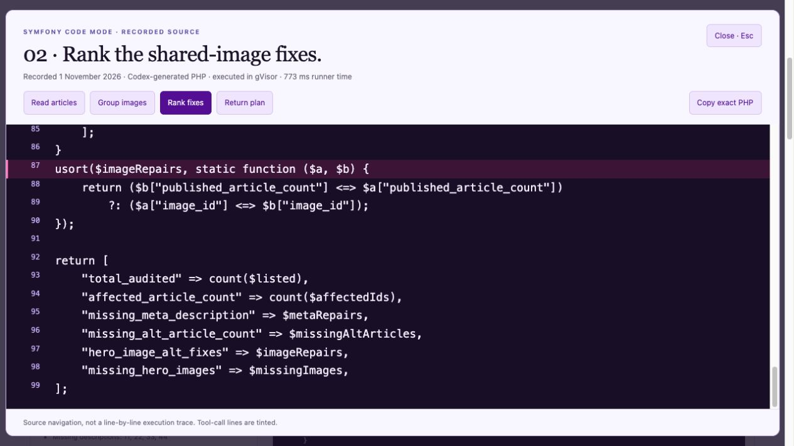

# Record the 90-second judge demo

**Symfony Code Mode: ask in Codex, let PHP do the data work, inspect the evidence.**

The previous rendered video and its slideshow renderer have been removed. The replacement will open with your actual Codex recording. Record the interaction at its natural pace; we will cut the finished footage to 90 seconds. Keep this Symfony-only.

## 1. Prepare the take

- Use the synthetic Symfony fixture and the existing [Codex MCP connection](../codex.md). Check registration with `codex mcp get symfony_code_mode` from this project. The configured gVisor host and runner image must be available. Codex uses its own model access; this conversation needs no Hugging Face key.
- Start a fresh, operator-authorized MCP process for the task. Its budget is **two PHP attempts, including failures**. Keep both for the two prompts; a new chat alone is not proof that the server process restarted. There is no agent-accessible reset.
- Record the Codex window at a readable size, preferably **1920 × 1080 or higher, 30 fps**. Hide unrelated chats and notifications. Keep tool arguments and results readable in the final 1080p crop. Do not record settings containing credentials.
- Record silently first; narration comes after the picture edit. Leave **three seconds before and after each action**. Keep the full original recording, including waits and any errors.
- Start `composer start` for the workbench. Existing local comparison/security reports can be reused. If they are missing, run `composer demo` and `composer demo:security` sequentially against the configured gVisor host. These are separate executions from the Codex conversation.

## 2. Capture these exact moments in Codex

Use the full copy-ready messages in [prompts.md](prompts.md), without adding expected answers or reference PHP.

| Capture | What must be visible | Hold after the action |
| --- | --- | --- |
| **A · The question** | Paste and submit the **First message — audit** prompt. Keep its request to audit published Symfony articles and stay read-only readable. | 5 seconds on the submitted prompt. |
| **B · Real execution** | Let Codex finish. Open the actual tool-call details available in your client: discovery (`tools_search` / `tools_describe`), then **`php_execute`**. Show its submitted `code` and returned result. Include the audit answer and total audited. | 6 seconds each on PHP, result and answer. |
| **C · The follow-up** | In the **same conversation**, submit **Follow-up — reshape the task**. Keep “shared hero images” and the request to recompute visible. Let the second execution finish. | 5 seconds on the prompt. |
| **D · The changed computation** | Open the second actual **`php_execute`** call. Show the new code, its returned repair plan, and **`toolCalls`** with tool names and statuses. Finish on Codex’s answer explaining the shared-image repairs. | 6–8 seconds per detail, scrolling slowly if needed. |

This can take several minutes. Do not rush generation or attempt to finish the interaction in the opening's 20 seconds. A failed execution stays a failed take; keep its original evidence. If the UI does not expose the raw request/result, retain whatever it does show and flag that gap before the edit. Model-written summaries do not replace raw tool results.

## 3. Show the PHP clearly

In the [workbench](http://127.0.0.1:8000/demo#codex-run), select **Follow-up → Generated PHP → Present PHP**. The large view has line numbers, tinted tool-call lines, and these navigation buttons:

1. **Read articles** — pagination and the authorized `$tools->call(...)`.
2. **Group images** — build the image-to-article groups.
3. **Rank fixes** — sort by the number of published articles helped.
4. **Return plan** — return the compact answer to the agent.

Hold each useful section for 5–8 seconds when recording inserts. **Copy exact PHP** copies the submitted body without line numbers or an added PHP opening tag. Escape returns to the workbench; open **Tool calls** for the host ledger and expand **php_execute · completed** for the outer MCP request/result. Source navigation is not a per-line execution trace; the runner does not record line-level timing.

**Match the take to its evidence.** Today this view reads the reviewed **1 November rehearsal**, not your newly filmed conversation. A fresh model run may produce different PHP and batching. For the preferred seamless edit, retain each new call's exact `arguments.code`, full raw result (including `value` and `toolCalls`), and the two prompts/responses. We can review that capture and update the checked-in evidence before recording the workbench inserts. Do not swap in new code while retaining old results or verification flags.

Until matching evidence is available, either show the new take's PHP directly in Codex (or copy its exact submitted body into a read-only editor tab), or use the current workbench with a visible **Recorded rehearsal · 1 November 2026** transition. The included narration uses that honest fallback. There is no upload, execution or conversation composer in the workbench.

## 4. The exact 90-second splice

Use hard cuts between real actions and remove generation waits. Do not speed-scroll through code or add a simulated execution cursor. At **30 fps**, the final timeline is **2,700 frames**.

| Timeline | Duration | Picture / edit |
| --- | --- | --- |
| **00:00–00:10** | 10s | Actual Codex: submitted audit question (4s), discovery/PHP call (3s), completed answer (3s). Small title: **Symfony Code Mode**. |
| **00:10–00:20** | 10s | Same chat: follow-up (4s), second `php_execute` (3s), repair-plan answer (3s). Keep enough conversation context to recognize the follow-up. |
| **00:20–00:35** | 15s | PHP insert: cut from the submitted code to the **same program** in Present PHP or the editor. Hold grouping (7s), ranking (5s), return (3s). If using the older workbench evidence, introduce its recorded date instead of implying continuity. |
| **00:35–00:48** | 13s | Workbench **Tool calls**: host ledger (8s), expanded actual MCP request/result (5s). The code and calls must belong to the same turn. |
| **00:48–01:00** | 12s | Separate **reference comparison**. Keep the “No model was called” label, equal call counts and payload definition visible. Caption: **Separate reference execution · 31 October 2026**. |
| **01:00–01:22** | 22s | Separate **security proof**: authorized read (5s), blocked tool (5s), infinite loop (5s), expanded loop trace with `wall_timeout`, read witness and checked removal (7s). Caption: **Fixed probes · 1 November 2026**. |
| **01:22–01:30** | 8s | Reusable Composer package README and repository URL. End on **Symfony AI + PHP MCP SDK**. |

The edit points are frames **0, 300, 600, 1050, 1440, 1800, 2460, 2700**. There is no old movie to splice into: assemble a new timeline from your footage and the workbench inserts. Record [narration.txt](narration.txt) after choosing the shots, then align [draft captions](captions.srt) to that voice track. If the new take replaces the rehearsal, change the rehearsal wording and all counts to its verified observations. Export H.264 MP4 at 1080p/30 fps, with readable captions and exactly 90 seconds.

## 5. Files to keep for the edit

Put the originals in ignored `var/demo-recording/` and provide their local paths when ready:

- `codex-two-turns.mov` (or `.mp4`): the untrimmed two-turn recording, plus any separate close-ups.
- `turn-1.php.txt` and `turn-2.php.txt`: **exact submitted bodies**, copied from tool arguments rather than an earlier proposed code block. Keep them as text; do not execute them on the host.
- `turn-1-result.json` and `turn-2-result.json`: full raw MCP results, if accessible; preserve returned values, tool ledger, errors and timing. Keep the corresponding prompts/responses and recording date.
- Workbench inserts and optional narration as separate files. Retain the original recordings when making cropped or trimmed copies.

The video is pending those manual recordings. No upload or submission is part of this step.

## Evidence and submission scope

The checked-in [Codex rehearsal](../evidence/codex-conversation-2026-11-01.json) has two different programs in one MCP process, each with **10 upstream calls**: four article-list pages, four article batches and two media batches. The follow-up rechecks **48 articles**; shared images **7, 14 and 21** each affect two articles. These are observations from that capture, not guaranteed counts for a new take. The host ledger records tool names, statuses, durations and result sizes; upstream arguments are visible in PHP, not separately logged.

The separate **31 October reference comparison** measured **20,154 → 3,014 tool-result bytes**, about **85% less**, with equal findings and ten calls each. This includes Code Mode discovery but excludes prompts, initial schemas and generated code. It is not a model-token, cost or latency measurement.

The separate **1 November security probes** show an authorized read, `tool_denied`, and `wall_timeout` after a successful read. Container absence was checked for all three. Their profile is **2 seconds / 128 MiB / three tool calls**; ordinary agent executions retain **15 seconds / 128 MiB / 30 calls / two attempts per process**. These checks demonstrate specific controls, not an independent security audit.

The [hackathon brief](https://symfony.com/hackathon), checked on 1 November 2026, requests Symfony AI and PHP MCP SDK integration, runnable public code and a 90-second video by **22 November 2026 at 18:00 CET**. It also asks entrants to use **Hugging Face Inference Providers**. Live Hugging Face inference remains unverified; the Codex footage and model-free comparison do not demonstrate that integration. Complete that check before submission and update the edit if a live comparison replaces the reference shot. The [verification record](../../packages/php-code-mode/docs/verification.md) describes the tested scope.
