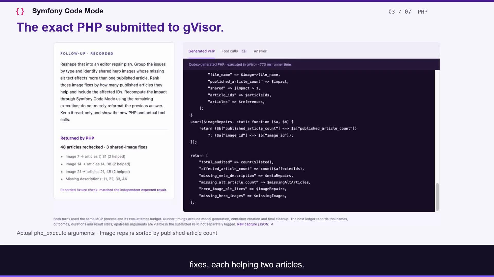

# Rendered judge walkthrough

[Watch the 90-second video](symfony-code-mode-90s.mp4) · [Captions](symfony-code-mode-90s.srt) · [Narration](narration.txt) · [Source hashes](provenance.json)



The video is **1920 × 1080, 30 fps, 90.000 seconds**, encoded as H.264 with stereo AAC audio and MP4 fast-start metadata. Captions are burned in and also supplied as SRT. The voice is the installed macOS **Daniel** voice, generated locally; it is synthetic narration. The 176-word rendered narration is shorter than the optional desktop recording script.

The opening uses exact excerpts from the [real two-turn Codex capture](../../evidence/codex-conversation-2026-11-01.json), with the recorded MCP sequence and returned values. It is explicitly labelled as transcript excerpts, not Codex UI footage: the available automation tool blocks access to the Codex window. The remaining evidence shots are actual browser screenshots, cropped and scaled for legibility, with editorial titles and held frames. This is an edited proof walkthrough, not a continuous live screen recording. No execution outcomes were retouched or invented.

The separate comparison remains labelled **reference / no model called**. The security shots use the reviewed [1 November fixed-probe report](../../evidence/security-proof-2026-11-01.json), copied unchanged from the local report. Rendering made no model calls, ran no PHP probes and changed no workbench behavior. The original Codex capture is unchanged. The final title card describes the repository package; it is not a Packagist listing.

## Rebuild

On macOS with FFmpeg (including libass) and the Daniel voice installed, run from the repository root:

```bash
python3 docs/demo/render.py
```

The renderer uses checked-in screenshots and evidence only. It creates intermediate frames, audio and clips under ignored `var/demo-video/build`, then writes the MP4, captions, narration, poster and provenance here. It needs no provider key, network access or running workbench. The macOS speech service must be accessible to the process. Platform font paths and the local voice are intentionally explicit.

The source screenshots in [../assets](../assets) were captured from the read-only workbench on 1 November 2026. The comparison, initial follow-up view and call ledger reuse the existing [proof screenshots](../../images/README.md). `provenance.json` records their hashes and the output hash. The renderer verifies the captured turn counts, host calls, security outcomes and exact audio/video durations before reporting success.

The video has been rendered locally and is ready to review. Uploading and hackathon submission have not been performed. Live Hugging Face inference remains a separate verification step before submission; the Codex capture and reference comparison do not prove it.
