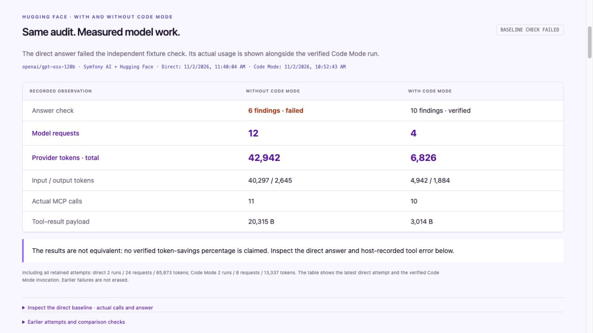

# Live Hugging Face baseline without Code Mode

Two direct-tool invocations were captured on **2 November 2026, at 11:38 and 11:40 CET**, using the same `openai/gpt-oss-120b` model ID, audit question, Symfony fixture and approved read permissions as the [verified Code Mode run](huggingface-proof.md). **Both direct answers failed validation.** Their actual usage and errors remain in the [baseline evidence](evidence/huggingface-baseline.json).

Open [Live comparison](http://127.0.0.1:8000/demo#live-comparison) to inspect the latest direct invocation alongside the exact reviewed Code Mode capture. Expand the requests, responses, host calls and earlier attempts. The workbench remains read-only.



## Recorded measurements

| Invocation | Model requests | Input tokens | Output tokens | Total tokens | Answer |
| --- | ---: | ---: | ---: | ---: | --- |
| Direct, first attempt | 12 | 40,297 | 2,634 | **42,931** | 6 findings; failed |
| Direct, second attempt | 12 | 40,297 | 2,645 | **42,942** | 6 findings; failed |
| Code Mode, earlier attempt | 4 | 4,643 | 1,868 | **6,511** | Wrong issue structure; failed |
| Code Mode, verified invocation | 4 | 4,942 | 1,884 | **6,826** | All 10 findings; passed |

All retained attempts total **24 requests / 85,873 tokens for direct**, and **8 requests / 13,337 tokens for Code Mode**. These totals include the earlier Code Mode attempt before its output-contract clarification. They record the captured work, rather than a controlled repeated benchmark.

Each direct invocation completed ten successful batched reads: four list pages, four article batches and two media batches. Captured responses contain all **48 published articles and 24 media records**, checked against the fixture. The model then requested nonexistent media IDs **25–36**, receiving a sanitized `tool_failed` response and an `incomplete` host-ledger entry. It returned six findings, omitting articles **31, 38, 44 and 45**. This upstream error is not presented as an authorization-denial proof.

Both direct invocations ended with a model-written final answer on request 12, without a request-budget exception. The second used unchanged prompts and settings. No further attempts were made to select a favorable outcome.

Each direct run returned **20,315 tool-result bytes**: 20,154 from successful reads plus the 161-byte error. The verified Code Mode run returned **3,014 bytes**, including discovery. Provider tokens are usage reported through Symfony AI across all requests; bytes count exact serialized toolbox results. No estimates or billing costs were substituted.

**The answers are not equivalent.** The workbench shows actual usage but suppresses a verified token-savings percentage. Successful results under matched conditions, followed by repeated measurements, are needed for a general performance claim.

## Comparison conditions

Both paths use Symfony AI Agent, its Hugging Face bridge, the PHP MCP SDK and the same host broker. Temperature is **0**, with **8,192 maximum output tokens per request**. The shared `DemoRunner` prompt/settings, dataset, fixture, allowlist and identity sources are unchanged from Code Mode implementation `ab0f529`; the baseline records reviewed source hashes. Shared safety/output instructions and the user question are unchanged. Approach-specific instructions and exposed tools differ: direct gets three batched reads; Code Mode gets search, describe and execute.

The direct capture records discovered definitions, aliases, a dataset hash and a SHA-256 reference to the reviewed Code Mode artifact. Comparison checks bind that artifact and compare model, question, endpoint, component versions and tool schemas. Identity remains `demo-editor` with `content.audit`; drafts and writes remain excluded. Data/permission continuity for the older Code Mode capture is supported by unchanged source history; a historical dataset hash has not been invented.

Hugging Face routes automatically. Serving provider and model revision were not recorded, so equality of those is not claimed. The invocations occurred at different times. No latency or billing comparison is made.

The direct request ceiling is **12**, allowing ten sequential reads and a final answer plus one extra request. Code Mode's ceiling was **8**, of which it used four. Direct retains the existing three-second tool deadline, configured 20-tool-round agent ceiling and 60-call toolbox admission ceiling. Request admission happens before provider invocation. No `php_execute` tool is exposed, and generated PHP is never evaluated on the host. Limit labels in the capture were corrected during review to distinguish rounds from individual calls; observations remain unchanged.

## Reproduce

With the existing runtime configured and `HUGGINGFACE_API_KEY` in ignored `.env.local`:

```bash
php bin/console code-mode:huggingface-proof --approach=direct --no-debug
composer start
```

The command checks model/question equality before inference and retains the shared factory's gVisor/image preflight, although direct execution allocates no guest. HTTP requests have a 60-second maximum duration and redirects are disabled. Failure exits nonzero and retains evidence. Earlier failed direct invocations are preserved on subsequent operator-started attempts. The separate Code Mode proof remains untouched.

Only ignored `var/demo/huggingface-baseline.json` is written. Reviewed evidence is not automatically replaced. A fresh checkout can view the committed pair without a token or execution. Fixed loopback-only GET endpoints accept no path selection or execution input. Captures omit credentials, authorization headers and provider diagnostics.

Validation: **77 application tests / 565 assertions**, **29 core tests / 44 assertions**, and **8 real MCP/gVisor regression tests / 99 assertions** passed. Tests cover real direct MCP reads with a mocked provider, mismatched/missing comparison evidence, and existing security/recovery scenarios. Browser checks confirmed the measurements, failed answer and eleventh call; the screenshot is unretouched. Both captures passed a scan for the actual local credential.
