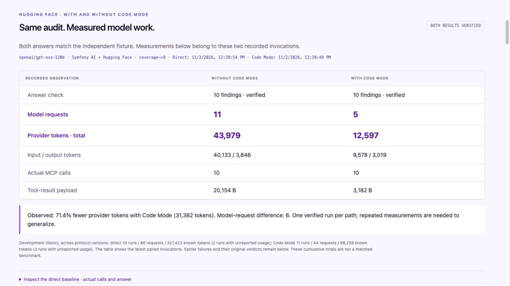

# A live comparison with correct answers on both sides

On **2 November 2026, 12:39–12:40 CET**, both agents returned all **10 findings across 48 published articles**, checked against an independent fixture oracle. The [complete capture](evidence/huggingface-pair.json) retains generated PHP, exact tool responses, host calls, provider usage, request digests and every earlier attempt.

Open [Live comparison](http://127.0.0.1:8000/demo#live-comparison) for the measured pair, or [Symfony AI run](http://127.0.0.1:8000/demo#huggingface-proof) for the generated PHP. The workbench is a read-only viewer; it cannot start inference.



| Observed in the final pair | Direct tools | Code Mode |
| --- | ---: | ---: |
| Correct findings | 10 | 10 |
| Published articles checked | 48 | 48 |
| Model requests | 11 | 5 |
| Input tokens | 40,133 | 9,578 |
| Output tokens | 3,846 | 3,019 |
| **Total provider tokens** | **43,979** | **12,597** |
| Successful MCP reads | 10 | 10 |
| Serialized tool-result bytes | 20,154 | 3,182 |

Code Mode used **31,382 fewer provider tokens (71.4%) and six fewer model requests** in this pair. Its payload includes discovery and one rejected `php_execute` call before tool description; that rejection allocated no container. The subsequent PHP execution succeeded, and its container was confirmed absent. Direct tools ran no generated PHP.

This is a successful pair obtained during development, **not a repeated benchmark or an estimate of typical savings**. We changed instructions while diagnosing failures. All attempts remain visible, so the successful pair does not hide that development cost. Hugging Face routes automatically; we verified the same requested model ID, but the serving provider is not identified. No billing or latency claim follows from these measurements.

## Why the original direct baseline missed four findings

Both original direct runs retrieved all 48 articles and all 24 referenced images. Their answers omitted:

| Article | Missing finding | Relevant data |
| --- | --- | --- |
| 31 | `missing_alt` | References image 7, also used by article 7 |
| 38 | `missing_alt` | References image 14, also used by article 14 |
| 44 | `missing_description` | Its own description is empty |
| 45 | `missing_alt` | References image 21, also used by article 21 |

They then requested nonexistent media IDs 25–36. The host rejected that request. Both still produced a final answer on request 12; neither was stopped by the request ceiling.

A replay test passes every original tool response through the real Symfony AI agent and Hugging Face HTTP serializer. It verifies byte-for-byte that all previous tool messages reach each outgoing request. Fresh captures additionally hash the tool messages presented to the platform and record each response's token usage and finish reason. There is **no evidence of client-side tool-result truncation**. The observed mistakes are consistent with confusing article and media IDs and losing findings while joining batches. We cannot establish the model's internal cause from these traces.

The old shared output instructions also mentioned PHP on the direct path. The new direct prompt removes that irrelevant instruction. A generic coverage checklist alone still missed articles 21 and 45. Higher reasoning exhausted the direct output allowance before a tool call; JSON mode was rejected; an unconditional review repeated the omission. Processing **one page's metadata and referenced images before advancing**, while retaining shared images and cumulative findings, produced the first correct direct answer. No expected IDs, counts or fixture answers were supplied to either model.

Code Mode's PHP repeatedly produced correct findings while its final model response abbreviated the JSON. Its final instruction now explicitly copies the entire PHP result into the answer. Both the executed result **and** final response must pass verification.

## Matched protocol: `coverage-v9`

Both paths use `openai/gpt-oss-120b`, the exact original question, the unchanged synthetic Symfony fixture, the same three batch-capable MCP tools and `demo-editor` with only `content.audit`. They share safety, coverage, pagination and page-wise joining instructions. The necessary approach-specific instructions differ: direct calls use MCP aliases; Code Mode discovers schemas and submits PHP.

Both request temperature **0**, `reasoning_effort: medium`, a maximum of **8,192 output tokens per request**, and a **14-request ceiling**. The final protocol has no extra review turn. Earlier defaults and ceilings are preserved in each historical record. Reasoning controls are documented in the [Hugging Face Chat Completion API](https://huggingface.co/docs/inference-providers/tasks/chat-completion); support and defaults depend on the provider and model.

Verification binds the direct capture to the exact Code Mode capture, compares full tool schemas, question, settings, identity and dataset digest, verifies both answers, recounts payload bytes, and reconciles per-request usage with the aggregate provider totals. All tool messages must still be present at the final request. The same independent oracle scores both paths after execution; its output never enters model prompts.

Security controls are unchanged: gVisor is mandatory, no guest network or host credentials, 128 MiB, a 15-second execution deadline, three-second tool deadlines, 30 broker calls per execution and two actual execution attempts. A rejected discovery precondition does not start or consume a sandbox execution. Every allocated container still needs positive cleanup evidence. Recovered tool errors are linked to their host-recorded reason and response size, never counted as successful reads.

## Retained development history

The original [Code Mode capture](evidence/huggingface-proof.json) and [failed direct baseline](evidence/huggingface-baseline.json) remain unchanged as historical evidence. The new pair embeds all earlier invocations with their original verdicts.

| Protocol | Code Mode outcome | Direct outcome |
| --- | --- | --- |
| Original | Invalid issue maps, then correct | Two runs with 6/10 findings |
| `coverage-v2` | Correct PHP; abbreviated final JSON | Not run |
| `coverage-v3` | Correct PHP and answer; checker falsely rejected pre-allocation cleanup | 8/10 findings; oversized media request rejected |
| `coverage-v4` | Correct PHP; abbreviated final JSON | Output limit reached before any tool call |
| `coverage-v5`, twice | JSON-mode request rejected; usage unavailable | Same; second attempt recorded the exception type |
| `coverage-v6` | Correct | 8/10 findings |
| `coverage-v7` | Correct PHP; extra review abbreviated final JSON | Extra review repeated 8/10 findings |
| `coverage-v8` | Correct PHP; abbreviated final JSON | Correct, 11 requests / 43,979 tokens |
| **`coverage-v9`** | **Correct** | **Correct** |

Across all protocols: Code Mode **11 invocations / 44 admitted requests / 98,259 known tokens**; direct **10 invocations / 86 admitted requests / 327,422 known tokens**. Each side has two rejected JSON-mode invocations with unreported usage; these are not counted as zero tokens. These totals describe development history, not equivalent repeated trials. The `coverage-v3` cleanup-check bug is fixed and tested, but its original captured verdict remains intact.

## Reproduce

Configure the existing gVisor runtime and ignored `.env.local`, then run:

```sh
php bin/console code-mode:huggingface-compare --no-debug
```

This consumes inference credits and captures both paths sequentially, preserving previous attempts in ignored `var/demo/huggingface-pair.json`. Missing credentials or a changed model prevent a run. Only a pair passing every check exits successfully. The command does not publish or overwrite checked-in evidence.

A fresh checkout shows the committed pair without a provider token or running sandbox. A local paired report takes precedence, including failures or incomplete runs. The legacy single-run command remains available, but the paired report is the primary workbench source once present. Only fixed loopback-only GET endpoints expose reports; credentials, authorization headers and provider diagnostic bodies are excluded.

Validation: dependency/configuration checks, the 96-test integration suite, 29 package tests and eight real gVisor demo tests passed. The sandbox tests used the configured pinned image and Docker command; test mode does not automatically load `.env.local`. Browser inspection confirmed both verified results, protocol inspection, tool calls and no console errors.
