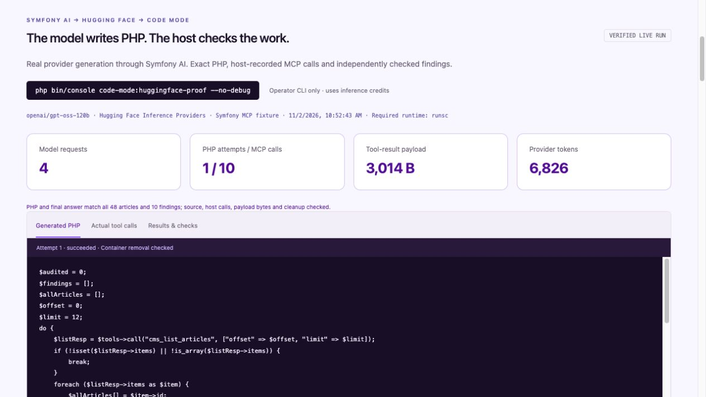

# Real Symfony AI + Hugging Face execution

On **2 November 2026 at 10:52 CET**, Symfony AI called `openai/gpt-oss-120b` through Hugging Face Inference Providers. The model discovered approved tools, generated PHP, executed it through the same `ronaldtebrake/php-code-mode` package used by Codex, and returned a verified editorial audit.

Open **[Symfony AI run in the workbench](http://127.0.0.1:8000/demo#huggingface-proof)**. Its three tabs show the exact submitted PHP, actual calls, and returned results with independent checks. Viewing the [checked-in capture](evidence/huggingface-proof.json) needs no provider key or running sandbox.

## Observed results

| Measurement | Successful capture |
| --- | --- |
| Articles audited / expected findings | **48 / 10**, both PHP output and final answer matched |
| Provider requests | **4** |
| PHP execution attempts | **1** |
| Host-recorded MCP calls | **10**: four list pages, four article batches, two media batches |
| Serialized tool results returned to the model | **3,014 bytes**, including search and description |
| Provider-reported tokens | **4,942 input + 1,884 output = 6,826 total** |
| Total capture time | **3.53 seconds**, including generation, setup and cleanup |
| Successful runner time | **787 ms**, excluding container creation and final cleanup |

These are observations from one run, not a performance benchmark. Tool-result bytes exclude prompts, initial schemas, generated PHP and protocol framing. The **85% payload reduction** elsewhere in the workbench belongs to the separate [committed with/without reference baseline](reference-baseline.md). We have not run a live direct-tool baseline, so this capture makes no token-savings claim.

The capture retains outer tool names, exact arguments and serialized results. The host ledger records each upstream tool's name, outcome, result size and duration. Upstream arguments are visible in the PHP; they are not separately logged. Hugging Face selected the serving provider automatically; the capture does not identify that provider.

## What Symfony contributes

Symfony AI's **Agent** drives tool discovery, code generation and the final response. Its **Hugging Face platform bridge** makes the real inference requests. The application supplies `AuditToolbox`, the existing PHP MCP fixture connection and the independent result verifier. The official **PHP MCP SDK** carries the upstream tool calls; the reusable **Code Mode package** enforces authorization and executes PHP in gVisor.

This uses the original audit integration and the same core Composer package. The newer Symfony bundle's optional `CodeModeToolbox` adapter has separate mocked-provider tests; this capture does not claim a live run of that adapter. [Symfony integration and contribution proposals](contributing/README.md).

## Failed attempt retained

The first real invocation returned the right articles with the wrong output structure: an issue map such as `{"missing_alt":true}` instead of a list such as `["missing_alt"]`. Both result checks rejected it. That invocation used four requests, one PHP execution, ten MCP calls, 3,064 tool-result bytes and 6,511 provider-reported tokens.

We made the output contract explicit in the system prompt, then started a new operator-authorized run. The verifier, tool permissions and sandbox limits were unchanged. Expand **Earlier live attempt** to inspect the first invocation, including its PHP, results and successful cleanup check. Its cost is separate from the successful capture's metrics; neither invocation is hidden or combined into a single attempt.

## Reproduce locally

1. Follow the [runtime setup](../packages/php-code-mode/README.md#run-the-proof) and run `php bin/console code-mode:doctor`.
2. Set `HUGGINGFACE_API_KEY` in ignored `.env.local` to a token with Inference Providers permission. Keep it out of recordings and source control. `HUGGINGFACE_MODEL` defaults to `openai/gpt-oss-120b`.
3. Run `php bin/console code-mode:huggingface-proof --no-debug`. This uses inference credits and exits unsuccessfully if required evidence fails validation.
4. Run `composer start` and open the workbench. A new local run replaces ignored `var/demo/huggingface.json`; it does not rewrite the reviewed, checked-in capture. The viewer prefers that local report and displays failures as failures. It falls back to the reviewed capture only when the local file is absent. An unreadable or oversized local report fails to load.

The command is a fixed audit of synthetic Symfony content. It checks runtime prerequisites before contacting Hugging Face. Requests are admitted **before** platform invocation, with an eight-request ceiling; transport failures still consume that budget. HTTP redirects are disabled and requests have a 60-second maximum duration. Each PHP execution retains the existing **15-second wall limit, 128 MiB memory, 30 broker calls and two-attempt session ceiling**. The host checks every tool call. No guest network, host mounts or credentials are added, and gVisor remains mandatory.

Successful verification requires matching PHP and final JSON results, exact submitted-source linkage to execution records, a matching host ledger, recounted payload bytes, observed model requests and independent Docker checks confirming every recorded container was removed. Provider exceptions are reduced to safe reason codes; authentication headers, keys and transport diagnostics are not saved. The real key was checked for absence from the reviewed capture before committing.

The browser only reads fixed report paths through loopback-only GET endpoints. It cannot start inference, upload PHP or reset execution budgets. These observations verify this development run; the separate security probes and [deployment limitations](../packages/php-code-mode/docs/security.md) still apply.

See the official [Symfony AI Hugging Face bridge](https://symfony.com/doc/current/ai/components/platform/huggingface.html) and [Hugging Face function-calling guide](https://huggingface.co/docs/inference-providers/en/guides/function-calling) for provider setup.
