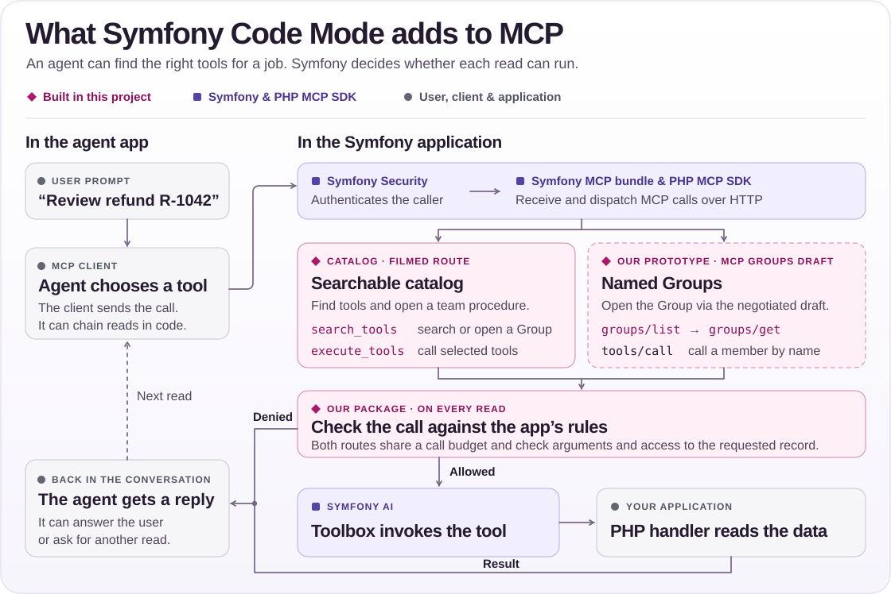

# From running PHP to discovering a team’s tools and procedure

A Symfony application already knows how to read an article, load an image and check who can see each one. The PHP MCP SDK can expose those operations to an agent. An editor’s question, “Which articles need fixing before we publish?”, needs all three. We built Symfony Code Mode to explore how an agent can put approved tools together for a job like that.

Our first implementation let the agent write the join in PHP. The version we demo today lets the application describe which installed tools belong to a job and optionally link the team’s procedure. The client can then make ordinary MCP calls, and Symfony checks access at each step. The question that led us from one to the other was what a team would actually have to host. [Watch the 90-second film](https://ronaldtebrake.github.io/symfony-hackathon/#demo-tour) · [Inspect the Publishing exchanges](https://ronaldtebrake.github.io/symfony-hackathon/#group-receipts)

## Why we let the agent write PHP

With direct tool calls the model had to read batches of article and image records, match the rows and identify the fixes. It could express the join in a few lines of PHP and return only the findings. We ran generated programs in a disposable gVisor guest. A broker held the credentials and authorized each call outside the guest. [Generated PHP and its tool calls](evidence/codex-conversation-2026-11-01.json)

On one matched Symfony AI audit, direct tools and sandboxed PHP found the same ten affected articles. Direct calls used 43,979 provider tokens in eleven model requests. PHP used 12,597 in five. In a smaller performance investigation, direct calls used 8,217 tokens and PHP used 14,694. The direct agent reused earlier results there. Regenerating and executing a program added work. The results made us ask when a team really needed an execution service. [Audit comparison and earlier attempts](huggingface-comparison.md) · [Performance investigation](performance.md)

## From PHP to JSON on the Symfony server

Most Symfony teams can deploy an HTTP controller and application services. Hosting arbitrary agent-written PHP also requires operating an isolation boundary. For known business operations we could accept a name and literal JSON arguments, then run the installed service. Pushpak Chhajed described a similar decision while building Laravel’s MCP catalog. That gave us an approach we could try on ordinary Symfony hosting. [Chhajed’s account of the move to JSON](https://laravel.com/blog/a-better-way-to-build-mcp-servers-with-laravel#version-four-switching-from-php-to-json) · [Independent Symfony HTTP proof](evidence/http-catalog-proof.json)

We exposed two MCP tools. `search_tools` ranks the contracts visible to the caller, using a search adapter based on Symfony AI’s BM25 proposal. `execute_tools` accepts an application-defined JSON envelope and applies the broker’s checks. On synthetic catalogs of 10 and 100 tools, advertising every definition took 865 and 8,605 tokens respectively. The two catalog definitions took 239 tokens at both sizes. These are offline measurements of the initial schemas. Retrieving contracts and completing a conversation incur additional costs. [Offline measurements](evidence/catalog-scaling.json) · [Search adapter and attribution](../packages/symfony-code-mode/src/Ai/Search/Upstream/README.md)

## Let an editor discover a workflow by name

The two-tool catalog solved a hosting problem and let clients search for individual operations. An editor, however, asks for a publishing audit. Why should each client have to work out which three readers to collect? The MCP Progressive Disclosure Working Group’s Groups draft gave us a common way to name that set. We implemented the toolset portion on an opt-in Symfony HTTP host. [Groups proposal #19](https://github.com/modelcontextprotocol/progressive-disclosure-wg/pull/19) · [Our PHP SDK extension](../src/Demo/Groups/PublishingGroups.php)

1. The client declares support on its modern MCP requests. `groups/list` returns the Publishing entry to the editor.
2. `groups/get` with `{"name":"publishing"}` returns three Symfony AI tool definitions. They describe how to list published articles, read article fields and look up images.
3. The client invokes the readers by name with ordinary MCP `tools/call`. Symfony checks the current grant, arguments and execution budget. The client decides which reader to call next.

The PHP MCP SDK already handles JSON-RPC, HTTP and the ordinary tool call. Our extension supplies the group methods, the set of readers visible to this caller and the connection to the same protected handlers. This path needs neither a batch envelope nor a sandbox on the Symfony server. Clients using the older MCP handshake can still use our two-tool catalog. A site with a handful of stable tools can also advertise them directly. [Symfony integration](../src/Demo/AuditMatrix/Gateway.php) · [Legacy client check](../tests/Integration/AuditMatrixTest.php)

The choice depends on the job. The sandbox gave the model a place to run a join over many rows. Groups lets a client discover related operations and call each one directly. The refund review only needs to pass a policy ID from one read into the next.

## How an MCP call reaches Symfony

The human conversation in the diagram illustrates the **Publishing prototype**. Its recorded protocol comparison used a scripted client. The separate refund study captures the agent loop. Its first user message asks for a review of R-1042. The host had already opened the group and given the model the two reader contracts. The model requested the order, used the returned policy ID in its next read, and answered the user. On the wire the client sent tool names and arguments. The follow-up continued the same conversation after permission changed. [User turns and MCP calls](evidence/refund-skill.json) · [Agent host](../src/Demo/RefundStudy/Study.php)

The current agent host uses Symfony AI’s released MCP bridge. For the catalog, its SDK-backed client lists and calls the two advertised tools. For a group, our adapter supplies only the schemas the authenticated host received from `groups/get`. The bridge gives remote tools a server prefix in the model’s toolbox and sends their original names over MCP. The provider totals below come from the earlier recorded conversations. [Catalog agent](../src/Demo/HttpConversation/Runner.php) · [Scoped study toolset](../src/Demo/Mcp/StudyToolset.php) · [Symfony AI MCP bridge](https://github.com/symfony/ai/blob/v1.0.0-BETA1/src/agent/src/Bridge/Mcp/McpToolbox.php)

On the server, Symfony authenticates the HTTP request. The MCP bundle passes it to the PHP SDK’s Streamable HTTP transport, which dispatches the JSON-RPC method. Our application supplies the catalog tools, Groups extension and access policy. [Host wiring](../src/Demo/AuditMatrix/Kernel.php) · [SDK server and dispatch](../src/Demo/AuditMatrix/Gateway.php)

| Client action | What happens on the server |
| --- | --- |
| Search for a capability | MCP `tools/list` advertises `search_tools` and `execute_tools`. The client calls `search_tools` via `tools/call` to retrieve matching schemas visible to this caller. It submits discovered names and literal JSON arguments to `execute_tools`. |
| Open a named group | A client that negotiates the draft extension can use `groups/list` and `groups/get`. It then calls a member by name with `tools/call`. The group response describes the tools. It executes no handler and grants no access. |
| Execute a read | Both routes use the same per-user budget and broker. The broker checks the operation and arguments against the application policy. An allowed call reaches the Symfony AI Toolbox. On a revoked read the tool result carries `tool_denied` and the handler never runs. |

The reusable Symfony integration ships the catalog. Groups is a prototype in the example hosts. The independent consumer exercises the catalog with a Symfony Security voter. The separate refund host uses grouped readers with its own permission policy. Its study client opens the group and optionally verifies a skill before the model chooses a tool and its arguments. [Catalog integration](../packages/symfony-code-mode/src/Http/CatalogTools.php) · [Toolbox invocation](../packages/symfony-code-mode/src/Ai/ApprovedTool.php) · [Publishing route tests](../tests/Integration/PublishingGroupsTest.php) · [Refund host](../src/Demo/Refund/Gateway.php) · [Refund study client](../src/Demo/RefundStudy/Study.php)

### What does this add to the SDK and Symfony AI?

For an app with a few known tools, the stock components already cover the basic interaction. The MCP bundle exposes named services through the PHP SDK. A Symfony AI agent can consume remote MCP tools, choose calls and answer the user. Symfony AI’s `#[IsGrantedTool]` can authorize a tool against resolved arguments before invocation. [MCP bundle](https://symfony.com/doc/current/ai/bundles/mcp-bundle.html) · [Symfony AI MCP client toolbox](https://symfony.com/doc/current/ai/components/agent/tools.html) · [Released authorization listener](https://github.com/symfony/ai/blob/v1.0.0-BETA1/src/ai-bundle/src/Security/EventListener/IsGrantedToolAttributeListener.php)

Our reusable package adds **server-side discovery and execution for a catalog of explicitly approved readers**. A client can call one search tool to retrieve the definitions visible to this user. Calling the execution tool submits one or more reads. For each read the integration checks the business operation and its arguments, and it keeps a per-user call budget across connections. Applications supply the actual rules. The original Symfony AI Toolbox still invokes the handler. [Server entry tools](../packages/symfony-code-mode/src/Http/CatalogTools.php) · [Call and budget handling](../packages/php-code-mode/src/BatchSession.php) · [Per-operation policy](../packages/php-code-mode/src/ToolBroker.php)

There is upstream overlap. Our ranking adapter uses an attributed snapshot of the proposed Symfony AI BM25 implementation. That proposal exposes matches to an agent through its toolbox. Our two entry tools serve external MCP clients. Separate open Symfony MCP bundle proposals address filtering native tool listings for a caller and authorizing a named MCP tool. Our Groups and Skills examples supply working-group feedback and reproducible access tests. Checked 20 November 2026 against the locked Symfony AI/MCP bundle 1.0.0-BETA1, PHP SDK 0.9.0, the SDK 0.10.0 release and the linked proposals. [Ranking source](../packages/symfony-code-mode/src/Ai/Search/Upstream/README.md) · [Proposed agent toolbox](https://github.com/wachterjohannes/symfony-ai/pull/87) · [MCP list filtering](https://github.com/symfony/ai/pull/2507) · [MCP authorization](https://github.com/symfony/ai/pull/2830) · [SDK 0.10.0](https://github.com/modelcontextprotocol/php-sdk/releases/tag/v0.10.0)

## What the Publishing capture proves

In the recorded Groups run, request 5 returns twelve article IDs. Request 6 passes those IDs to the article reader. After four pages, the editor has four articles with missing descriptions, **11, 22, 33 and 44**. The operator revokes the audit grant at that point. Request 13 names an image reader the client has already discovered. Symfony returns `tool_denied` before its handler runs. The editor keeps the four findings and sees that the image check is incomplete. With access throughout, the same audit checks 24 images and finds three missing alt text. [Requests, editor output and Symfony traces](evidence/editorial-groups.json)

We ran both permission scenarios through three discovery paths against the same three readers. Each full audit made ten reader calls. The client used a maintainer-written program so it would ask for the same fields and stop at the same checkpoint every time. All six runs were model-free.

| How the client found all three readers | Discovery requests | Total requests for the full audit | Offline discovery tokens |
| --- | ---: | ---: | ---: |
| Browse the three-reader catalog once | 2 | 13 | 988 |
| Open the Publishing group | 3 | 14 | 1,080 |
| Search for each reader by name | 4 | 15 | 1,032 |

Browsing once was cheapest in this fixture. The totals include protocol negotiation. The token counts cover one copy of each discovery result and exclude execution, prompts and answers. What Groups demonstrated here is named, permission-aware discovery. An agent choosing the right group among many plausible tools, and the cost of that conversation, still need a live trial. [Discovery measurement](evidence/editorial-groups-footprint.json)

## Give the group a procedure as well as tools

Publishing showed that an app can name a useful set of tools. The working group posed a different question with its refunds example. What if the team also owns a procedure for using those tools? We tried Option 2 in the positioning paper. The group lists the skill’s Markdown URI as an ordinary resource beside the tool schemas. The host can verify the manifest with `skills/get`, read the file with `resources/read`, and offer the two readers to the agent. The authors also discuss a different design in which skills themselves would declare tools. [Working group positioning paper](https://github.com/modelcontextprotocol/progressive-disclosure-wg/pull/22) · [Skills over MCP](https://skills.extensions.modelcontextprotocol.io/specification/beta/skills)

Our **refund-review** group offers a guide, an order reader and a policy reader. The guide explains the review procedure. The amount paid, item condition, age and current thresholds come from the authorized reads. In the fixture, R-1042 is unopened and nine days old. Its €75 value exceeds the €50 manual-review threshold within the 30-day return window. The app can inform a support rep’s decision. It has no payment operation. [Protocol and permission checks](evidence/refund-protocol.json)

The follow-up asked for a fresh policy check after the operator revoked the support rep’s grant. Symfony denied the known policy reader before its handler ran. The agent reported that the review was incomplete. A separate control removed access after group discovery and before the first guide download. Symfony denied both the manifest and the Markdown reads. [Protocol and access traces](evidence/refund-protocol.json)

### Did the separate skill help?

For this order, **the two readers were sufficient**. The order supplied the policy ID. The policy returned its window, accepted condition and manual-review threshold. The question explicitly asked the model to consult both records. Almost everything the checklist suggested was already apparent from the question and tool results. [Exact questions and system prompt](../src/Demo/RefundStudy/Study.php) · [Reviewed checklist](../src/Demo/Refund/skills/refund-review/SKILL.md)

| Guidance given to the model | Host MCP setup calls | Model requests | Provider tokens | Correct turns |
| --- | ---: | ---: | ---: | ---: |
| Two readers alone | 3 | 5 | 2,481 | 2/2 |
| Same readers + inline checklist | 3 | 5 | 3,092 | 2/2 |
| Same readers + linked skill | 5 | 5 | 3,055 | 2/2 |

The linked form added two host calls to fetch and verify the file. Both guided runs supplied the same checklist text to the model. Against the bare group, the linked skill took **574 more provider tokens (23%)**, with 456 more in prompts and 118 more in completions. This compares entire conversations. The 37-token difference between inline and linked comes from the individual model exchanges, so it gives us little reason to prefer either delivery method for cost. We captured one conversation per setup. The host chose the group and how to load its guidance. [Inspect the refund study](https://ronaldtebrake.github.io/symfony-hackathon/#refund-attempts) · [All requests and usage](evidence/refund-skill.json)

For this job we would ship the group on its own. Linking a skill demonstrated something else the protocol can deliver. A team can maintain a procedure in a separate file, and an authorized host can discover and verify it alongside the tools. We have yet to show that doing so improves a decision enough to justify the extra work.

## What to test next

A better skill trial would include a routine order and an exception that the tool schemas cannot settle. For example, how should support handle a refund for a split shipment? Give every setup access to the same written procedure through the same authorized reader. Then compare ordinary discovery, an inline checklist and an optional skill. Score the decision and the evidence behind it, including whether the client recognizes when it needs the procedure. Repeat the cases and count every model request, host call and provider token. This would test both the value of guidance and the cost of loading it on jobs where it adds little.

The working group can already use our permission-change case to discuss what clients should do with an earlier group reference. Selecting the right group from several plausible choices and replaying a recurring job from a saved script remain separate questions. [WG reference prototype](https://github.com/modelcontextprotocol/progressive-disclosure-wg/pull/20) · [Contribution notes](contributing/README.md)
