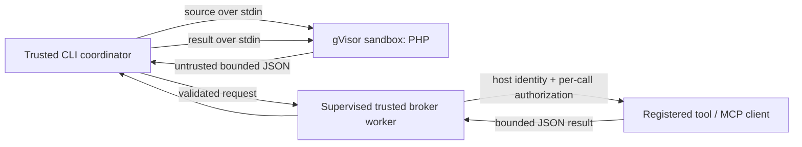

# Security model and runtime decision

Status: runner, broker and Code Mode demo proof, 31 October 2026. These tests demonstrate specific controls; they do not prove the absence of sandbox escapes or make this ready for anonymous multi-tenant hosting.

## Decision: native PHP in gVisor, deployed through Docker

We need real PHP with functions, loops, arrays, and tool composition. The generated program is fully hostile. It must never execute in the Symfony/Drupal process, receive credentials, or select its own execution profile.

| Option | Boundary and adoption | Decision for this proof |
| --- | --- | --- |
| Local PHP process, `disable_functions`, AST filtering | Same host access; language restrictions are bypass-prone and do not contain native vulnerabilities | Rejected as an isolation boundary |
| Hardened Docker/runc | Familiar tooling and native PHP, but containers share the host kernel | Insufficient alone for hostile generated code; no fallback |
| Docker + gVisor | Standard OCI image; a userspace application kernel intercepts application syscalls; requires Linux and installation of `runsc` | Selected; native PHP works, resource controls are testable, and systrap works inside an ordinary VM |
| Wasmtime / WASI PHP | Strong capability-oriented boundary with fuel/epoch interruption; requires a maintained compatible PHP build and host bindings | Worth revisiting; the archived VMware PHP WASI release and a custom runtime port are a maintenance burden for this proof |
| PHP.wasm / WordPress Playground | Demonstrates active PHP-on-Wasm work; Emscripten/JS host integration adds another runtime and capability configuration | Possible future adapter; not treated as a ready-made secure CLI execution profile |
| Firecracker / Kata / dedicated microVM per run | VM-level boundary, with VM orchestration, hardware requirements, image lifecycle, and additional operational cost | Strong candidate for higher-assurance hosting; beyond the current proof |

Docker is the adoption interface, not the security argument. gVisor reduces the application's direct exposure to the host kernel. Its own code, the host kernel, Docker daemon, and runtime configuration remain trusted. A dedicated Linux sandbox host adds separation from application infrastructure. The macOS development VM is a convenience; it is not a clean production security domain because OrbStack itself integrates with the developer's host.

The executor requires a configured `runsc` binary and rejects unreviewed runtime flags (only explicit `--platform=systrap` is allowed). It inspects each created container before starting it. This detects configuration errors; it cannot attest that a malicious administrator has installed genuine gVisor under that name. Rootless Docker is desirable additional hardening but has **not** been verified by this proof; no rootless compatibility claim is made.

## Trust boundaries

Trusted: package code, pinned image, Docker endpoint/argv, host identity, local tool registration, permission callbacks, configured MCP endpoint and tool implementations. Untrusted: generated PHP, all guest output, tool names/arguments requested by the guest, upstream schemas/descriptions/data, and the final answer. JSON schemas never fetch external references. Discovered schemas are parsed and validated inside supervised workers; they cannot authorize a tool.

The guest has no host mount, Docker socket, application/vendor directory, host environment forwarding, network interface with egress, published port, device passthrough, host PID namespace, or elevated Linux capability. Its root filesystem is read-only. It runs as UID/GID 65532 with `no-new-privileges`; only a private bounded `/tmp` is writable. `/tmp` is `noexec`, but PHP can still interpret PHP stored there: `noexec` is not a ban on interpreted code. The entire interpreter is already untrusted.

`eval()` exists only in the isolated image bootstrap. PHP function restrictions, `-n`, and disabled URL wrappers are defense in depth. They are not the isolation boundary. The guest can forge the entire STDIO protocol and result. Every frame is parsed on the host with exact keys, depth/size limits, and sequential request IDs. Neither an identity nor a capability can be supplied in a frame. The host decides the tool allowlist for each execution, then checks permission and argument schema for every call. Tool-name lookup never resolves arbitrary PHP functions or shell commands.

## Enforced limits

| Resource | Default | Enforcement |
| --- | --- | --- |
| Guest wall time, including startup attachment and tool work | 5 seconds; configurable 100 ms–30 s | Monotonic host watchdog; forcibly remove the container on cancellation |
| Independent guest watchdog | `ceil(wallTimeMs / 1000) + 2` seconds | BusyBox timeout inside the container; survives host coordinator SIGKILL, followed by Docker AutoRemove |
| Guest memory | 128 MiB total cgroup, no additional swap; PHP heap 32 MiB | Docker/gVisor memory limits plus PHP heap limit |
| CPU | 1 CPU quota | Docker cgroup |
| Host tasks in execution cgroup | 128 | Includes gVisor Go threads; 16 prevented the runtime from starting in the test VM |
| Guest file descriptors / core dumps | 64 / zero | OCI rlimits |
| Writable temporary storage | 4 MiB | Private tmpfs, nodev/nosuid/noexec |
| Tool calls | 10; maximum 100 | Host counter before dispatch |
| Per-tool work | 1 second | Parent supervises a separate broker process; kills its process group on timeout |
| Broker fallback timer / PHP heap | `ceil(toolTimeMs / 1000)` seconds / 64 MiB | SIGALRM in broker child, even if parent disappears; PHP memory limit |
| Source / JSON frame / aggregate guest output | 32 KiB / 16 KiB / 64 KiB | Count bytes before evaluation/dispatch; stdout and stderr share output budget |
| Tool response / pending guest input | 16 KiB / 512 KiB | Broker serialization limit and bounded write queue |
| JSON nesting | 32 | Host protocol parser and broker serialization |

The guest transport reads at most 8 KiB per channel per tick. A continuously full pipe cannot prevent returning to the deadline check or force unbounded buffering. Guest diagnostics are discarded and Docker logging is disabled. Tool exception messages are not returned; they may contain host secrets.

Docker preflight/create/inspect/remove operations each have their own 15-second timeout, outside the guest execution deadline. Wall time is therefore not an SLA for the complete API call. Cleanup failures fail the execution. An ordinary process failure uses explicit removal; AutoRemove and the independent watchdog handle a killed/disconnected coordinator after execution starts. The broker also terminates; after its parent is killed, the OS init/subreaper must reap its process-table entry. Deploy with a proper process supervisor. A crash between create and start can leave an unstarted container: deployment supervision must reap stale `php-code-mode.managed=true` containers. A daemon/VM outage cannot be repaired by this library.

## Verification and remaining limits

The integration suite runs real hostile PHP under `runsc`. It checks authorized calls and host identity, denied/unknown tools, schema and identity injection, forged/after-result messages, CPU loops, sleeping, PHP memory exhaustion, stdout/stderr floods, source/frame/result/call limits, a stalled handler and oversized tool response, private temporary storage, host-file/secret denial, read-only root, and removal after success, failure, and host SIGKILL. Network denial is checked against a server that a separate trusted control container successfully reaches. Missing infrastructure fails the suite.

Memory exhaustion tests the PHP heap limit; the cgroup memory/swap, CPU, PID and other OCI settings are inspected before execution. This is not a native exploit, kernel escape, side-channel, or aggregate-load test. Image updates and runtime updates require re-running the suite. The image base is pinned by digest; execution uses the built immutable image ID. The installer pins the signed `runsc` package. A pinned image still needs vulnerability monitoring and updates.

Production deployment still needs:

- An independently reviewed security boundary, patched kernel/runtime/images, trusted signed build distribution, and a dedicated sandbox host with restricted administrative access.
- Authentication, request/concurrency/tenant quotas, queue admission, global CPU/memory budgets, and stale-container supervision. Per-run limits do not prevent many concurrent runs from exhausting a host.
- Broker workers supervised by an OS service/container with aggregate resource limits. PHP's broker heap limit does not account for all native-extension allocations. Tool handlers are trusted code; the worker is for time supervision, not a sandbox for malicious handlers.
- Fresh connections opened in broker handlers after fork. No inherited database/MCP sockets, cross-tenant global state, or detached background work. Tools need their own upstream timeouts and bounded queries/responses.
- A policy for tool side effects, retries/idempotency, and durable audit logging. Killing a timed-out handler cannot reverse a remote action already committed. Execution exceptions retain completed/incomplete calls before failure. Incomplete does not mean rolled back. Cleanup errors can override the execution exception, and process death can lose the in-memory ledger. Durable logging remains deployment work.
- Rendering/escaping of guest output and a data-access policy at the tool service. Allowing a generic URL fetcher, SQL tool, filesystem reader, or unrestricted administrative MCP tool can bypass the intended data boundary through the broker. Successful execution does not imply a truthful or safe answer.

## MCP and demo boundary

The package includes bounded MCP discovery, a fresh-client gateway and progressive discovery sessions. The caller configures the endpoint, transport timeouts and allowed names; generated PHP cannot select a server, credential, transport command or identity. Explicit local policy and upstream account/object access must both allow a call. Do not infer safety from `readOnlyHint` or a tool's prose. The fixture deliberately advertises an unapproved delete tool as read-only to exercise this distinction.

The demo connects through STDIO to its PHP fixture or through HTTP to a configured Drupal MCP endpoint. HTTP redirects are disabled; bearer credentials remain in the host client. HTTPS is required except for trusted loopback development. Discovery is limited to 128 upstream tools, 8 continuation cursors, 64 KiB output and a 3-second supervised worker. Each schema/description is also bounded. Both gateway operations use a 64 MiB PHP worker heap; upstream transports need response/time bounds too because JSON decoding can allocate native memory.

Symfony AI requests PHP, then receives only tool results. Model/tool prose cannot change runner policy. Code Mode has at most two execution attempts with 15 seconds and 30 broker calls each; individual tools have 3 seconds. The direct baseline uses the same approved tools and per-tool supervisor. Provider/model round counts can differ and are measured, not fixed to favor either path. Model output and CMS content remain untrusted even after an audit matches a fixture.

The browser only reads a fixed local report through GET, with local client/Host checks, no-store headers, a restrictive CSP and text-only rendering of untrusted values. Execution starts from an operator CLI or locally configured STDIO MCP client. This is not public-service authentication. The HTTP `app_status` MCP endpoint is a separate foundation example and exposes no executor. Approved CMS results can reach the configured model provider and the local report; choose tools/data accordingly.

The workbench also reads a fixed question catalog through GET and constructs a quoted CLI command locally. It cannot submit questions or start execution over HTTP. Changed questions are bounded UTF-8 user-message data and are supported only against the Symfony fixture in live mode. They do not change host identity, tool policies, endpoints or limits. Custom JSON answers are explicitly unverified even after successful execution. All question and result rendering uses text; question control characters are rejected before execution.

The Drupal HTTP adapter is protocol-tested against a local MCP server; it has not yet been verified against a Drupal installation. Live inference requires a host Hugging Face key and remains a separate verification step. Mutation approval workflows and a public HTTP execution endpoint are outside this proof.

## Sources

- [Docker security](https://docs.docker.com/engine/security/) and [rootless mode](https://docs.docker.com/engine/security/rootless/): daemon privileges and kernel isolation tradeoffs.
- [gVisor security architecture](https://gvisor.dev/docs/architecture_guide/security/), [platforms](https://gvisor.dev/docs/user_guide/platforms/), [installation](https://gvisor.dev/docs/user_guide/install/), and [Docker integration](https://gvisor.dev/docs/user_guide/quick_start/docker/): application-kernel boundary and deployment requirements.
- [Wasmtime security](https://docs.wasmtime.dev/security.html) and [VMware language-runtime releases](https://github.com/vmware-labs/webassembly-language-runtimes/releases): capability isolation versus the PHP runtime maintenance requirement.
- [WordPress PHP.wasm packages](https://developer.wordpress.org/playground/developers/architecture/php-wasm-packages/): the alternative PHP/Wasm integration model.
- [Firecracker design](https://github.com/firecracker-microvm/firecracker/blob/main/docs/design.md): microVM architecture and operational requirements.
